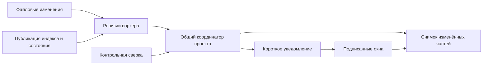

# Обновления окон — общий снимок проекта и подписка на изменения

Статус 01-11-2026: проект шага 3.5.6; предложение агента для согласования OQ-232, **не реализовано**. Проверены существующие цепочки окна, Tauri, обработчика воркера и файлового слежения. Замер 3.5.5 определяет источник лишней работы; выигрыш предлагаемой схемы, большой корпус и WebView2 ещё не измерены. Реализация относится к 3.5.7.

Основано на: [требованиях Т-1, Т-10, Т-33, Т-40 и НФТ-5](../MAIN_IDEA.md), [замере опроса](../knowledge/window-poll-2026-10-28.md), [политике активности и слежения](../features/indexing/updates.md), [дереве и файловых операциях](../features/knowledge-base/tree-and-files.md).

## Задача и предел решения

Убрать повторные обходы неизменённого проекта и передачу целого дерева каждую секунду. Сохранить немедленный показ собственных файловых операций, внешние изменения, пустые папки, подсказки `[[` в отдельных окнах, прогресс и уведомления. Обновление снимка не запускает embed, не меняет область поиска и не подменяет буфер редактора.

На 588 документах видимое главное окно расходовало 4,2 % одного ядра; почти вся работа — `status`, `tree`, `tree_read`. Множитель окон уже устранён в 3.5.1; скрытое окно почти не добавляет нагрузки. Поэтому перенос прежнего секундного цикла в Rust без устранения его работы не решает обнаруженную причину. Эти числа — одна серия на общей машине, не норматив CPU и не доказательство поведения на 10 000 документах.

Поручение автора 01-11-2026 начать 3.5.6 разрешает подготовку проекта. Оно не является выбором конкретного механизма. До согласования OQ-232 действуют нынешние частоты; существующая рекомендация измерить большой корпус сохраняется как проверка перед внедрением.

## Сравнение вариантов

| Вариант | Выигрыш и цена | Вывод |
|---|---|---|
| Оставить опрос в WebView | Минимум изменений; весь обход и JSON остаются каждую секунду | Исходная версия для сравнения |
| Общий секундный опрос в приложении | Убирает дубли одинаковых запросов, но одно главное окно уже единственное; прежняя стоимость трёх методов остаётся | Недостаточно без ревизий и общего снимка |
| Полный поток событий через публичный IPC | Полезен внешним клиентам, но потребует доставки, восстановления и нового контракта MCP/CLI | Не нужен для этой задачи: окно и воркер в одном процессе |
| Внутренняя подписка + общий снимок в приложении | Перечитывание только изменившихся частей, одна сборка на проект, короткие уведомления; нужны полнота инвалидирования и контроль потерь | Рекомендация |

Предлагается гибрид: внутренние уведомления от воркера и файловых команд, общий координатор в `bars-app`, контрольная сверка с ограниченной частотой. Лёгкий опрос уведомлений и активности остаётся существующим. Новые зависимости и публичные методы MCP/CLI не требуются.

## Владельцы состояния и граница модулей

| Слой | Ответственность |
|---|---|
| `bars-worker` | Поколение регистрации проекта; ревизии опубликованного индекса и состояния; уведомление о файловых изменениях и потере слежения. Без Tauri и без WebView |
| `bars-app` | Координатор наблюдаемых проектов; снимок дискового дерева из `tree_io::read_tree`, сведения индекса и статус; объединение запросов; ограничение памяти; адресная рассылка ревизий |
| UI | Подписка по назначению окна; загрузка изменившихся частей; защита по проекту/поколению/номеру запроса; построение дерева только при новой ревизии |
| Редактор | Собственный контроль версии, запись, конфликты и сохранение при выходе; снимок дерева не заменяет текст документа |

Точки внедрения: `worker/mod.rs` и обработчики публикации индекса/очередей; `worker/watcher.rs`; новый координатор `bars-app`; `commands.rs`, `Shared`, обработчики жизненного цикла окна; `app.svelte.ts`, `DocumentWindow.svelte`, `api.ts` и заглушка. Текущий `tray.rs` читает дешёвую `summary()` для состояния и мигания; перевод трея на события не нужен для устранения измеренных обходов.

## Идентичность и ревизии снимка

Ключ: канонический зарегистрированный путь, поколение регистрации и нормализованный `docs_root`. Повторная регистрация того же пути, смена корня или перезапуск воркера создают новую идентичность. Один путь не позволяет принять старый ответ.

Снимок содержит отдельные части: дисковые `files/dirs/problems`, метаданные документов индекса и `StatusOutput`. Каждая имеет монотонную ревизию и состояние `ready/loading/error`; общий `epoch` меняется при пересоздании координатора. Ревизия ошибки меняется независимо от списка файлов: исчезновение ошибки тоже должно попасть в окно. Хеш текущего `tree_read`, не включающий `problems`, не годится как единственный признак свежести.

`disk_revision` относится к наблюдаемому дереву, `index_revision` — только к опубликованным транзакциям индекса. Индексация может отставать от диска: новый файл показывается без индексных метаданных, удалённый скрывается даже при старой записи SQLite. Это согласованное объединение двух источников, а не обещание общей транзакции диска и индекса.

## События, которые инвалидируют снимок

| Причина | Какие части перечитать |
|---|---|
| Запись, создание, перенос, корзина через bars, включая частично успешную операцию | Диск немедленно; индекс только после его публикации; затронутые проекты определяются фактическим результатом |
| Внешнее создание/удаление/перенос/изменение файла или папки | Диск после пачки слежения; отсутствие файла в индексе не мешает событию |
| Транзакция документа, удаление из индекса, подмена SQLite после rebuild | Индекс и статус, после успешной публикации; прерванная транзакция не публикует новый снимок |
| Очередь, scan, прогресс, пауза, ошибка, завершение, согласие на переиндексацию, доступность проекта | Статус; список проектов остаётся по действующему расписанию |
| Смена настроек модели/корня, регистрация/удаление проекта | Статус; при смене корня/регистрации новый ключ и полный снимок |
| Ошибка watcher, Rescan, переполнение внутреннего канала | Все части помечаются требующими сверки; последний снимок не объявляется свежим |

Уведомление создаётся после фиксации состояния и освобождения замков. Обработчик события только увеличивает ревизию и будит координатор; не обходит диск, не открывает SQLite и не ждёт UI. Изменения прогресса объединяются до одного обновления в секунду; завершение/ошибка/явное действие будят сразу.

## Слежение за дисковым деревом

Использовать один источник `notify` на активный проект, с двумя потребителями: индексирование и снимок UI. Сигнал дереву должен отделяться **до** фильтра индексации. Фильтр `is_relevant` сейчас судит о последнем компоненте по расширению: папка `module.v2`, особенно после удаления, может быть отброшена. Пустые папки также не представлены в индексе. Это делает подписку только на нынешний `WatchEvent::Files` неполной (связанный ISS-73).

Для дерева консервативно инвалидировать допустимый корень при структурных событиях; исчезнувший путь нельзя классифицировать только через `is_dir()`. Избыточная пачка допустима, пропуск папки — нет. Правила видимости и безопасности берутся из существующего обхода: символические ссылки и выход за корень не открываются ради классификации события. Индексационный фильтр и пауза Т-41 остаются отдельными.

При отсутствии активных окон служба снимков не запускает обходы, даже если MCP держит watcher. Скрытие снимает UI-наблюдение, как сейчас; активность MCP не продлевается внутренним чтением координатора. Окна разных проектов имеют независимые подписки.

## Один сборщик, повторные сигналы и границы памяти

Для каждого ключа — один выполняющийся сборщик и набор флагов `disk/index/status dirty`. Перед работой он запоминает входные ревизии; IO и сериализация идут вне глобальных замков. Повторные читатели ожидают тот же результат. Событие во время сборки оставляет флаг для следующего прохода; завершение старой работы не стирает новый сигнал.

Устаревшее поколение не публикуется. При непрерывных правках допустим последний полный промежуточный снимок с признаком обновления; нельзя бесконечно отбрасывать результаты и оставлять пустое окно. После прекращения событий должен последовать один окончательный проход. Не накапливать список всех событий: хранить флаги и последнюю ревизию.

Предлагаемые инженерные пределы: одновременно не более двух IO-сборок в приложении, один проход на проект; объединение пачки 250 мс с максимальным ожиданием 1 с от первого сигнала. Уже накопленные watcher 500 мс не должны превращаться в дополнительные 1,5 с ожидания окна. Явное действие обходит debounce, но присоединяется к уже идущему проходу и требует повтор, если тот стартовал до действия.

Кэш переиспользуемых снимков — до 32 МиБ и до 8 проектов; оценка включает строки и векторы частей, без повторной сериализации для подсчёта. Неактивные записи вытесняются первыми. Большой снимок возвращается потребителям без удержания в общем кэше; удержание активных ответов и память WebView измеряются отдельно, лимит кэша не объявляется лимитом процесса. Удаление последнего подписчика освобождает запись; IO заканчивается без публикации для снятой идентичности.

Ревизии и dirty-флаги живут отдельно от вытесняемых данных. Вытеснение не означает изменение источника и не сбрасывает ревизию: клиент с актуальной частью получает `unchanged`, новому клиенту собирается полный ответ. Одновременные запросы большого снимка объединяются на время сборки даже без его последующего кэширования.

## Мост Tauri и гонка первого снимка

Предлагаемые внутренние команды (не методы публичного IPC):

| Команда/событие | Контракт |
|---|---|
| `window_observe(project, parts)` | Tauri получает настоящее окно из контекста, связывает подписку с ним, возвращает идентичность и текущие ревизии; повтор заменяет подписку этого окна |
| `window_snapshot(subscription, known, force)` | Возвращает изменившиеся части или `unchanged`, их ревизии и ошибки; `force` делает проверку, не запускает индексирование |
| `bars://project-changed` | Адресно подписанным окнам: идентичность, изменённые части, новые ревизии; без целого дерева и текста документов |
| снятие наблюдения | Скрытие, закрытие, переключение, уничтожение WebView; снимается только соответствующее окно |

UI сначала устанавливает слушатель, затем подписывается, затем получает снимок. Уведомление, пришедшее до ответа, сохраняется как последняя требуемая ревизия. После ответа UI дочитывает ещё раз, если полученная ревизия ниже требуемой. Команда проверяет принадлежность подписки настоящему окну; произвольный ID из JS не даёт доступ к чужой подписке.

Поздние ответы прежнего проекта/поколения/запроса игнорируются. Пропуск ревизии не означает потерю данных: окно получает последнюю полную часть. Разрыв `epoch`, перезагрузка WebView или восстановление связи требуют полного снимка. Ошибка чтения сохраняет последнюю успешную часть с видимой пометкой; пустое дерево публикуется только как успешный ответ.

## Контрольная сверка и поведение окон

Для каждого видимого проекта — одна контрольная сверка через 30 с после последней успешной полной сверки, без множителя окон. Она перечитывает диск, индексные метаданные и статус, сравнивает части и посылает уведомление только при перемене. После потери событий сверка немедленная; при ошибках повтор с паузами 1, 2, 5, 10, 30 с, последующие — 30 с. Это UI-сверка, не дополнительный scan индексации по Т-10.

Файловые события в штатном режиме должны проходить критерий T-01 дерева (до 2 с на контрольном корпусе); 30-секундная сверка — восстановление после молча потерянных событий, не обещание двух секунд при отказе watcher. Сам факт ошибки виден сразу, если система её сообщила. При показе окна всегда немедленная полная сверка; ошибка не снимает предупреждение о старом снимке.

Главное видимое окно подписано на дерево/индекс/статус. Отдельное окно документа — только на дерево и метаданные для `[[`; не выбирает проект главного окна. Если все окна проекта скрыты, сборки и контрольный таймер проекта прекращаются. Оставшийся дешёвый `activity/operation_events` сохраняет нынешние интервалы: видимое главное окно — 1 с, скрытое — 10 с; `models_info` по экрану/операциям, проекты/темы/аудиты по существующим правилам.

Продление `project_observe` раз в 10 с и истечение через 30 с сохраняются; Tauri связывает регистрацию снимка с тем же жизненным циклом, без второго независимого срока жизни. Ручное «Проверить сейчас» сохраняет запуск scan и ожидание текущего/следующего обновления с «Проверяем…»; новый force снимка не заменяет эту команду и не подтверждает смену модели.

## Последовательность реализации и удаляемые пути

1. Счётчики ревизий и внутренний канал воркера; точки публикации и отдельный сигнал структурных изменений. Проверить изменения через окно, CLI/MCP, внешний редактор и фоновые задания.
2. Координатор приложения, снимки, объединение запросов, пределы и контрольная сверка; прежние источники данных используются для построения частей.
3. Tauri-подписка, handshake и lifecycle; подключить главное и отдельные окна, заглушку и тесты.
4. Удалить секундные `status/tree/tree_read`, локальный таймер сверки дерева и отдельный debounce дерева документа. Старые вызовы, ещё используемые файловыми командами или публичным IPC, сохраняются по их собственному контракту; второй фоновой схемы рядом не оставлять.
5. Проверить сценарии и ресурсы, обновить описания действующего поведения и руководство; проверить собранное окно. Установленная сборка — после разрешения установки.

При разработке сначала обеспечить события и восстановление, затем отключать прежний опрос. Постоянный feature flag и дублирующий polling-fallback не предлагаются: контрольная сверка уже является явным механизмом восстановления.

## Проверка корректности схемы

| Сценарий | Ожидаемый результат |
|---|---|
| Одно и четыре окна одного проекта без изменений | Одна контрольная сверка на проект; нет ежесекундных обходов/передачи дерева |
| Все окна скрыты, одно показано вновь | Нет фоновых сборок скрытого проекта; при показе свежий снимок, уведомления сохранены |
| Два проекта, закрытие/смена/удаление и повторная регистрация | Независимые подписки; старые результаты не публикуются в новый проект |
| Собственные/внешние создание, перенос, корзина, пустая папка и папка с точкой | Дерево и `[[` актуальны до индексации, критерии T-01/T-02 сохранены |
| Изменение при подписке или во время долгого обхода | Событие не потеряно, есть последующий проход; ожидание ограничено |
| Потеря канала, Rescan, ошибка watcher, тишина после потерянного события | Последний снимок с предупреждением; явное восстановление или контрольная сверка |
| Полный rebuild и конкурентное чтение | Не смешаны поколения SQLite; ошибки не заменяют успешный снимок пустым |
| Очередь, прогресс, согласие на модель, ошибка и завершение | Статус актуален; UI-чтение не загружает модель и не продлевает MCP-активность |
| Ошибки обхода появились/исчезли при тех же путях | Уведомление и `problems` обновились |
| Поток событий, большой снимок, медленное окно | Ограниченная очередь/кэш, одна сборка на проект, нет блокировки producer |
| Несохранённый документ, ручное обновление и закрытие | Буфер, диалог конфликта и НФТ-5 не изменились |

## Ресурсная проверка и решение о внедрении

Перед 3.5.7 снять базовую стоимость настоящего `tree_io::read_tree` на 10 000 документах (`measure_tree_10000_documents`) и отдельно `tree/status`; один тест обхода не измеряет CPU всего окна. Затем сравнить старую и новую схему на одном фиксированном корпусе, не во время параллельной сборки: по три серии 60 с после прогрева для одного видимого, скрытого и четырёх окон; отдельно пачка внешних правок и работа индексации.

Записать хеши исходников/корпуса, число обходов и RPC, CPU-секунды bars и WebView, логические байты чтения, передачу JSON, p95 свежести, private commit/Working Set и удержание кэша. Не подменять физический IO логическим; совпадение списка файлов/папок/метаданных и отсутствие потерь важнее экономии CPU. Проектная цель: в устойчивом простое не более двух контрольных обходов в минуту на видимый проект, ноль при всех скрытых окнах; добавление окон не умножает сборки.

Подтвердить существенное снижение остаточной работы и отсутствие ухудшения свежести и задержек поиска на одинаковой машине. Конкретный процент CPU заранее не обещается. Если выигрыш не подтверждён, не выдавать внедрение за оптимизацию; вернуться к OQ-232 с данными. Инженерные пределы 250 мс/1 с/30 с, 32 МиБ/8 проектов и две IO-сборки — предлагаемые значения для согласования и проверки, не новые требования MAIN_IDEA.
