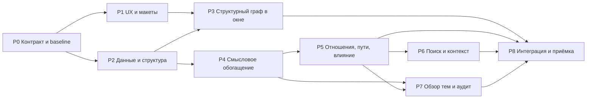

# План оставшихся работ GraphRAG в bars

Что осталось сделать по [ТЗ GR-01…GR-12](requirements.md) и [контрактам инструментов](tools.md); сделанное описано в [implementation.md](implementation.md), `tools.md` и статусе фичи. Исследование качества возобновлено 20-10-2026; полный состав и приёмка остаются открытыми.

Решения автора: автоматическое локальное обновление, только чтение и evidence, один выбранный проект (OQ-85…87); сначала существующие embeddings, ссылки и явные связи, новая модель — только после показанного недостатка и обсуждения (OQ-91). Цель — все S1–S8, шесть операций, режимы hybrid/mix/graph и общий/локальный граф. Структурный граф, один работающий инструмент или хороший средний score — промежуточные результаты. Платформенная и модельная непроверенность не считается выполненной; неудача метода требует его пересмотра, а не исключения сценариев.

## Карта зависимостей этапов

P0–P8 обозначают внутренние зависимости GraphRAG, а не готовность пользовательских этапов. Рамка раунда 17 и поправка [GR-05](requirements.md#gr-05-графический-просмотр-и-пользовательские-действия) согласованы с уточнениями автора OQ-109/OQ-111: новые исследования физики/renderer, макеты панели и вида запроса предшествуют новому UI-коду. Прежние макеты P1 не являются согласованным дизайном нового окна. P4 начинает с проверки метода без новой модели.

## Перенос физического вида Т-46

Основание реализации — [проект узлов, трёх видов и силы](physical-graph.md), подготовленный 21-10-2026; проверка формул и сохранённых снимков — итог сессии (`chats/2026-10-21-physical-graph-design`).

- [ ] Макет панели: обе темы/размеры, различимость силы и типов, раскрытие/сворачивание, список/инспектор, плотные компоненты и изоляты; согласование с автором.
- [ ] Калибровка document-centroid-v1 на настоящих векторах обоих проектов; фильтр области до top-k, кэш/инвалидизация/отмена, partial по слоям.
- [ ] Rust-проекция и контракт среза: направление/происхождение, бюджеты, накопительное продолжение, согласованный snapshot; затем worker/Canvas, hit-testing и действия окна.
- [ ] Нативные проверки обоих проектов по матрице проекта физического вида; одновременные поиск/чтение, stop/hidden/reduced motion, ресурсы и длительный idle. Установка только по действующему согласованию OQ-106/OQ-113; macOS отдельно.

## P0. Контракты и набор проверки

- [ ] Уточнить словарь predicates, direction/traversal, qualifiers/polarity, ObjectRef, source span и роли контекста; согласовать схему DTO и ошибок и публичный переход старых клиентов.
  - [x] 22-10-2026: словарь связей, направления, полярность, ключи квалификаторов и решения по полям v1 — [tools.md](tools.md); пять изменений приняты автором (OQ-142).
- [ ] Измерить ресурсные лимиты фоновой работы и конфигурацию задания; автор численные пределы не задавал.
  - [x] 22-10-2026: проект пределов фонового задания и умолчаний по операциям — [implementation.md](implementation.md#пределы-выполнения); измерение на 5 000 чанков и под нагрузкой поиска открыто.
- [x] Заморозить первый real-corpus gold/development/holdout: 20-10-2026, 66 документов/503 чанка, 32 случая S1–S8 и 4 контроля; методика и ограничения независимости. После использования этот holdout не считать новым.
- [x] Снять первый matched baseline без rerank: hybrid 30/5, 100/20, structural и mix при 16 KiB, с повтором на сохранённых query vectors. Пороги из implementation зафиксированы до запуска и не менялись; качественная приёмка не пройдена, подробности — [исследование](../../knowledge/graph-research.md#проверка-извлечения-на-корпусе-20-10-2026). Парный прогон с rerank и статистически достаточные контроли остаются в P8.
- [ ] Заполнить default/max budgets обоснованными значениями, tokenizer и учёт бюджета, корпус и железо, p50/p95, пределы памяти и влияния фоновой работы; обновить `requirements.md` и `tools.md`.

**Выход:** нет неразрешённых параметров, необходимых следующему этапу; независимый набор существует.

### Очередность исправлений после исследования 20-10-2026

Исправления по наблюдениям; сделанные части отмечены отдельно. Это не решение о новой модели.

1. [x] 23-10-2026: метод v6 исключает `не → requires`, отделяет условие «Без драйвера Vulkan», проверяет итоговые имена после очистки; 21 прежняя цитата — regression, все 8 поддержанных фактов сохранены. Правила — [implementation.md](implementation.md), доказательства — `chats/2026-10-23-graph-extraction/`.
2. [ ] Сущности и цепочки: подтвердить полезность разрешения участников на естественном корпусе и новом наборе 4.1.7.
   - [x] 23-10-2026: явные технические ID и локальные aliases с evidence объявления; неоднозначные алиасы не связываются, короткие embed/rerank разных файлов не сливаются. Трёхшаговая цепочка извлечена из трёх Markdown-фикстур и возвращена с evidence каждого шага. Повтор на 66 прежних документах: 15 отношений, 2079 точных spans, межфайловых сущностей/двухшаговых цепочек 0; полезность естественных цепочек не заявляется.
3. Контекст: отбирать релевантные evidence до расходования `max_nodes` по порядку хешей; роли behavior/constraint определять по содержанию и статусу источника. Проверять нужные факты внутри роли: наличие меток ролей и пустой `missing_roles` не доказывают полезность контекста.
4. Retrieval: устранить потери S7 от чередования соседей, сохранить преимущества S1/S5; повторить сравнение с увеличенным top-K, rerank и новым holdout при прежнем бюджете. Не объявлять выигрыш только относительно слабого baseline.
5. Темы и аудит: сохранить полезный отбор представителей communities, убрать ложное покрытие неизвестной темы общими словами; отдельно проверить текущие решения, условия, структурные дефекты и смысловые кандидаты.
6. Контракт/lifecycle/UI: закрыть подтверждённые capability gaps, per-file progress/errors и накопительное раскрытие; ресурсное обновление и native Tauri — P2/P3/P8. После изменений заново проверить S1–S8 и границы пользователей; IDEA-11 пока не закрывать.

## P1. UX и макеты до кода окна

- [ ] Макеты поиска hybrid/mix/graph: основные совпадения, связанные evidence bundles, пути, типы оценок, отключение related, ограничения бюджета.
- [ ] Состояния включения, прогресса и отмены обогащения, partial/stale/error/empty; конфликт источников, большой хаб, длинные подписи, удаление выбранного объекта.
- [ ] Проверить интерактивные макеты в обеих темах, узком окне, с клавиатурой и reduced motion; сохранить снимки и сценарный протокол.

**Выход:** для каждого сценария известен путь пользователя от запроса или узла до оригинала; layout-проверка отделена от работы настоящего воркера.

## P2. Схема графа, source map и структурное обновление

- [x] 23-10-2026: снятие актуальности старых evidence в транзакции текста, пересборка входящих ссылок, snapshots/cursors, общая очередь ручного и автоматического построения, отмена/продолжение и постоянная пауза. Проверки bars-graph/worker/CLI и отдельный программный Tauri/WebView2; поведение — [реализация](implementation.md).
- [x] 23-10-2026: добавочные метаданные схемы v1, неполное покрытие с ошибками файлов, отказ запоздалой публикации и сохранение прежнего набора при отмене проверены на временных индексах; embedding-схема не меняется.
- [ ] Установленная версия (OQ-113); ресурсные пределы под нагрузкой.

**Выход:** все детерминированные фикстуры span/link/scope/lifecycle проходят; переиндексация embeddings без необходимости не запускается.

## P3. Структурный просмотр и навигация

- [ ] Инспектор, точное открытие оригинала, пины и камера, фильтры, список и все структурные состояния P1; уничтожение renderer и layout jobs при закрытии.
- [ ] Большие степени узлов и ограниченное раскрытие, continuation и stale; не рисовать «полный граф», если получен ограниченный срез.
- [ ] Проверка Tauri/WebView2/WKWebView, лицензий и версий выбранного renderer.

**Выход:** переходы к источникам проверены через настоящий worker и Tauri отдельно от браузерных фикстур.

## P4. Смысловое обогащение

- [ ] На development-наборе проверить существующие embeddings, ссылки, явные правила и ID по всем S1–S8: русский язык, отрицания, qualifiers, entity linking, provenance. При конкретном недостатке показать источники, потерянный результат и варианты автору; encoder или generative extractor до обсуждения не добавлять.
- [ ] Если расширение стека понадобится: runtime, веса, tokenizer, лицензия, совместимость с `ort`, ресурсный бюджет; решение оформить ADR.
- [x] 23-10-2026: очередь, fingerprints/поколения слоёв, revision check, отмена/продолжение, ошибки файлов и следующая автоматическая проверка; выбранный слой сохраняет только актуальные остальные слои. Read-only операции не запускают построение или модели. Per-file extraction cache пока не реализован.
- [ ] Несколько evidence, конфликты, aliases, условия; после правки или удаления старый результат extraction не становится текущим.

**Выход:** достигнуты зафиксированные extraction floors и лимиты ресурсов. Если extractor не прошёл, меняется метод или модель; co-occurrence не подменяет предикаты.

## P5. Отношения, пути, влияние

- [ ] Индекс отношений и алиасов, разрешение имён, `bars_relations`; polarity и qualifiers, различие ранга и статуса проверки.
- [ ] Паритет CLI/DTO/MCP/Tauri, граф сущностей и смешанный вид, инспектор assertion/evidence и подсветка пути.
- [ ] Циклы, хабы, scope промежуточных узлов, совпадения имён, изменения ревизии, conflicting qualifiers.
- [ ] Реальное извлечение и качество цепочек `paths` и `impact` оценить отдельно от обхода по заданному графу; `change_description` у `impact` пока недоступен.

**Выход:** эталонные пути и влияние корректны, каждая связь открывает основание.

## P6. Поиск и контекст

- [ ] Расширять кандидатов до окончательного top-K; сравнить structural expansion, typed BFS, path ranking/PPR и их сочетания на одинаковых seeds.
- [ ] Отбор связанных evidence bundles с общей ценой; сохранение оснований каждого перехода.
- [ ] `bars_context`: поддержка `roots` и `include_related`, точный tokenizer mode; приёмка полноты на реальных задачах.
- [ ] Карточки поиска по P1: отдельные related, оценки, усечение, переход к графу и обратно; выключенный граф и недоступная модель.
- [ ] Сравнение с простыми альтернативами при фиксированных устройствах, порогах и бюджете; регрессии точечных запросов и качество каждой S-группы.

**Выход:** достигнуты критерии P0 без скрытого снижения порога и разрыва доказательств; старые клиенты и hybrid проходят регрессию.

## P7. Тематический обзор и аудит

- [ ] Версионированные groups/communities; сравнение с группировкой по модулям и embeddings; отчёты — только при доказанной пользе и учтённой цене.
- [ ] `bars_explore`: topics, connectivity, coverage, conflict_candidates; фильтры корпуса применяются до употребления summaries.
- [ ] Структурные дефекты отдельно от смысловых пробелов; «проверка не извлечена» не смешивается с «проверки нет».
- [ ] Тематический масштаб общей карты, просмотр представителей, связей и кандидатов конфликтов; незавершённое обогащение видно в каждом режиме.
- [ ] Изменение состава сообщества, удаление источника, пересчёт групп вне изменённого файла; цена обзора.

**Выход:** S6 и S8 проходят отдельные критерии P0; top-K одной темы не выдаётся за покрытие корпуса.

## P8. Сквозная интеграция и приёмка

- [ ] Последовательный прогон S1–S8: MCP/CLI, настоящее окно и воркер, переходы поиск ↔ граф ↔ исходник; фикстуры и реальные данные записать раздельно.
- [ ] Обновление, удаление, rename, падение и возобновление задания, миграция, просроченные refs/cursors, scope, частичные ответы.
- [ ] Полный измерительный прогон: построение, правка, прогрев, query, UI, p50/p95, RAM/VRAM/диск, конкуренция с поиском и индексацией; holdout без подстройки.
- [ ] Регрессия существующих функций и профилей клиентов; оба режима rerank, fallback, прежние числовые контракты hybrid.
- [ ] Финальные UI-проверки P1 на настоящем приложении; Windows и macOS по доступности отдельно.
- [ ] Обновить фактические schema/protocol/search/MCP/CLI/window docs, настройки и инструкции агентам, changelog и IDEA-11; сохранить доказательства с ревизиями и параметрами.

**Выход:** все критерии ТЗ подтверждены либо фича остаётся частично выполненной с точным списком хвостов. Установка, публикация и release — отдельные поручения.

## Матрица покрытия сценариев

| Сценарий | Основные этапы | Инструменты и интерфейс | Финальная проверка |
|---|---|---|---|
| S1 влияние | P4/P5/P6 | impact, context, mix, граф влияния | P8 + размеченные затронутые источники |
| S2 отношения и пути | P4/P5 | relations, paths, сущности и смешанный граф | P8 + правильность каждого ребра |
| S3 контекст | P5/P6 | context, роли в выдаче, выбранный подграф | P8 + полнота ролей и бюджет |
| S4 условия | P4/P5/P6 | relations, context, graph, qualifiers | P8 + отрицания, условия, конфликты |
| S5 решения | P4/P5/P7 | relations, explore, статусы и цепочки | P8 + выбор текущего основания |
| S6 темы | P7 | explore, тематический масштаб | P8 + широта и представители |
| S7 промежуточные понятия | P5/P6 | paths, mix, context | P8 + добавочные полезные источники |
| S8 аудит | P2/P3/P5/P7 | graph, explore, impact | P8 + структура отдельно от смысловых кандидатов |

P0 задаёт критерии и эталоны каждой строки, P1 — UX, P8 — общую приёмку.

## Риски и условия пересмотра

| Риск | Действие до продолжения |
|---|---|
| Нет точного русского extraction | Сравнить методы и словарь на development; co-occurrence не выдавать за зависимость |
| Graph retrieval не лучше простых альтернатив | Сохранить результаты по S-группам, пересмотреть seeds и отбор; holdout не менять ради принятия |
| Большие хабы, дорогой layout | Ограниченное раскрытие, свёртка групп, отмена работы, список; проверить renderer на тех же данных |
| Нестабильная идентичность | Source spans и revisions, явное stale; ordinal и заголовок не вечный ID |
| Фоновое обогащение мешает поиску | Бюджеты, очередь, отмена, раздельный статус слоёв, измеренный предел регрессии |
| Требуется новая БД или runtime | Обоснование по целевым запросам, проверка сборки и лицензии, решение по расширению стека |
| Открытая продуктовая развилка | Не выполнять зависимое действие; продолжать независимый контракт, структуру и UX |

Сроки оцениваются после P0 и выбора extractor; порядок этапов описывает технические зависимости, а не приоритеты прочих поручений автора.
