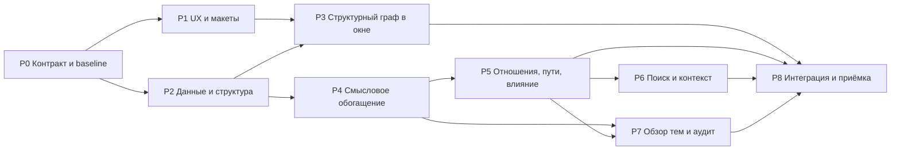

# Поэтапный план внедрения GraphRAG в bars

Статус на 18-10-2026: реализация этапа 33 по [ТЗ GR-01…GR-12](requirements.md) и [контрактам инструментов](tools.md) продолжается. Общий слой, публикация, шесть операций, MCP/CLI/worker, поиск и компонент окна реализованы; инварианты/IPC/headless проверены отдельно от качества и native-приёмки. [Development snapshot](../../knowledge/graph-corpus-2026-10-18/Index.md) сохраняет ревизии и недостатки разбора. По OQ-85…87 обновление автоматическое и локальное, исходники только читаются, граф одного выбранного проекта. По OQ-91 используются существующие embeddings, ссылки и явные связи; новая модель не добавлена. Полный состав P0–P8 не принят.

## Итог внедрения и правило завершения

Текущий срез остановлен по просьбе автора 18-10-2026. [Проверки и точные ограничения](../../knowledge/graph-renderer-2026-10-18/validation.json) сохранены; продолжение полного состава требует нового поручения. Открытые пункты ниже не закрывать по факту остановки.

Цель — все S1–S8, шесть read-only операций, режимы hybrid/mix/graph и общий/локальный просмотр документов, разделов/чанков, сущностей и смешанного графа. Структурный граф, один работающий инструмент или хороший средний score — промежуточные результаты.

Этап закрывается только при готовом результате, относящихся к нему проверках и записанных границах. Платформенная/модельная непроверенность не становится выполненной задачей. Неудача выбранного алгоритма требует пересмотра метода, а не молчаливого исключения сценариев.

## Карта зависимостей этапов

Окно любого последующего смыслового этапа следует проверенным макетам P1; изменения в контракте/поведении обновляют макеты до соответствующего UI-кода. Решения OQ-85…87/91 получены: автоматическое локальное обновление, только чтение/evidence, один проект, сначала существующие embeddings/явные связи. P2/P3 не требуют новой extraction-модели; P4 начинает с проверки метода без неё.

## P0. Зафиксировать исполнимые контракты и набор проверки

**Зависимости:** новое поручение на реализацию; документальное проектирование этого этапа может продолжаться отдельно. **Покрытие:** все S1–S8, GR-01/GR-09/GR-10.

- [ ] Уточнить словарь predicates, direction/traversal, qualifiers/polarity, ObjectRef, source span и роли контекста; согласовать схему DTO/ошибок и публичный переход старых клиентов.
- [x] Получить решения OQ-85…87/91: автоматическое локальное обновление, только чтение/evidence, один выбранный проект; сначала существующие embeddings/явные связи. Новая модель не добавляется без показанного недостатка и обсуждения.
- [x] Выполнить [первый development-опыт на готовых векторах](../../knowledge/graph-embedding-2026-10-18.md): Rust kNN, 104 документа/569 chunks, 8 MCP-вопросов, 9 графов; полный snapshot сохранён, 7 Rust и 4 Node-теста. Не заменяет следующие пункты baseline/holdout/quality floors; наивный expansion не принят.
- [ ] Измерить ресурсные лимиты фоновой работы и конфигурацию задания; ответы автора не задают численные пределы.
- [x] Подготовить эталонный граф без модели: positive/negative/conditional по S1–S8 в `bars-graph/tests/acceptance.rs`; source spans, scope, refs/cursors и независимые evidence проверены. Это детерминированные фикстуры, не real-corpus holdout.
- [ ] Заморозить реальный corpus manifest/revisions и development/holdout; исключить формулировки исследования/журналов из независимой оценки. Разметить необходимые evidence и допустимые альтернативы.
- [ ] Снять hybrid baseline и простые альтернативы на одинаковом бюджете; утвердить измеримые quality floors/допустимые регрессии по группам и точечным контролям до holdout.
- [ ] Заполнить конкретные default/max budgets, tokenizer/budget accounting, корпус/железо, p50/p95 и пределы памяти/влияния фоновой работы; обновить `requirements.md`/`tools.md` обоснованными значениями.

**Результат:** валидируемые DTO/контрольные примеры, manifest/разметка, таблица порогов и бюджетов с происхождением. **Выход:** нет неразрешённых параметров, необходимых следующему этапу; независимый набор существует. Три прежние поисковые пробы — материал исследования, не замена P0.

## P1. Спроектировать и проверить UX/UI до кода окна

**Зависимости:** P0 — пользовательские операции и состояния. **Покрытие:** все S1–S8, GR-05/GR-11.

- [x] Макеты видов графа, тематического масштаба, общего/локального режима и инспектора: `window/mockups/graph.*`, существующая палитра. [Протокол и снимки](../../knowledge/graph-renderer-2026-10-18/Index.md).
- [ ] Макеты поиска hybrid/mix/graph: основные совпадения, связанные evidence bundles, пути, типы оценок, отключение related и ограничения бюджета.
- [x] Макеты шести операций: отношения/неоднозначность, две вершины/пути, влияние, роли контекста, группы тем/аудит, общий/локальный подграф. Headless-проверки тестовых данных, отдельно от native worker/Tauri.
- [ ] Состояния включения/прогресса/отмены обогащения, partial/stale/error/empty; конфликт источников, большой хаб, длинные подписи и удаление выбранного объекта.
- [ ] Проверить интерактивные макеты в обеих темах, узком окне, с клавиатурой/reduced motion; сохранить снимки и сценарный протокол.

**Результат:** реальные макеты в `window/mockups/`, их оглавление и описания переходов. **Выход:** для каждого сценария известен путь пользователя от запроса/узла до оригинала; layout-проверка отделена от работы настоящего воркера.

## P2. Схема графа, source map и структурное обновление

**Зависимости:** P0 — модель данных и миграция. **Покрытие:** основание всех сценариев; структурная часть S8, GR-02/GR-06/GR-07.

- [x] Добавочная SQLite-схема графа 1, source spans/sections/nodes/edges/evidence, method fingerprint/snapshot и состояние задания; embeddings schema остаётся 1. Транзакционная миграция и сохранение прежних vectors проверены storage-тестами.
- [x] Реализовать исходные диапазоны без ложных связей из padding/служебных заголовков; ID/ревизии и stale. Проверки BOM/CRLF/CR/UTF-8, chunk spans и старых refs.
- [x] Inline/reference links, anchors, исключение кода; unresolved targets/внешние пути различаются, scope применяется до обхода.
- [ ] Сделать транзакционное снятие старых evidence, переопределение входящих ссылок при правке цели, snapshots/cursors и отмену/возобновление обновления.
- [ ] Проверить миграцию и отказоустойчивость на временном профиле; прежние индекс/поиск сохраняются при неполной перестройке.

**Результат:** структурный граф и согласованное обновление. **Выход:** все детерминированные фикстуры span/link/scope/lifecycle проходят; переиндексация embeddings без необходимости не запускается. Новый смысловой extraction пока не требуется.

## P3. Структурный просмотр графа и навигация

**Зависимости:** P1 + P2. **Покрытие:** документы/разделы/чанки, структурный S8 и навигационное основание остальных.

- [ ] На одних данных сравнить Cytoscape/Sigma по времени открытия/layout, реакции выбора, pan/zoom и памяти; выбрать renderer с проверкой Tauri/WebView2/WKWebView, версии и лицензии.
- [x] Реализованы `bars_graph`, CLI `graph show`, общий Tauri handler, общий/локальный граф и виды document/section/chunk/entity/mixed. Настоящее окно ещё требует native-приёмки.
- [ ] Реализовать инспектор, точное открытие оригинала, пины/камеру, фильтры, список и все структурные состояния P1; уничтожать renderer/layout jobs при закрытии.
- [ ] Проверить большие степени узлов и ограниченное раскрытие, continuation/stale; не рисовать «полный граф», если получен только ограниченный срез.

**Результат:** рабочая структурная карта и инструмент чтения. **Выход:** переходы к источникам проверены через настоящий worker/Tauri отдельно от браузерных фикстур; бюджет и lifecycle renderer соблюдаются. Это не закрывает смысловые S1–S7 или весь GraphRAG.

## P4. Выбрать и внедрить смысловое обогащение

**Зависимости:** P0 + P2, решения OQ-85 и применимой части OQ-86. **Покрытие:** смысловая основа S1–S8, GR-02/GR-06/GR-08.

- [ ] На development-наборе сначала проверить существующие embeddings, Markdown-ссылки, явные правила/ID по всем S1–S8; отдельно русский язык, отрицания, qualifiers, entity linking и provenance. При конкретном недостатке показать источники, потерянный результат и варианты автору; encoder/generative extractor не добавлять до обсуждения (OQ-91).
- [ ] Проверить runtime/веса/tokenizer/лицензию, совместимость с текущим `ort`, CPU/выбранным ускорителем и ресурсный бюджет. Конкретный пакет не считать подходящим без опыта сборки и инференса.
- [ ] Зафиксировать выбор/отказ по результату; при расширении стека оформить ADR с реальным решением, не переписывать MAIN_IDEA инженерным предположением.
- [ ] Реализовать очередь, cache fingerprint, revision check, отмену/перезапуск, retries и ошибки файлов; явные GraphBuild/GraphCancel и статус слоёв без скрытого скачивания из read-only tools.
- [ ] Сохранять несколько evidence, конфликты/aliases/условия; после правки/удаления старый результат extraction не становится текущим.

**Результат:** воспроизводимое извлечение отношений и управляемое обогащение. **Выход:** достигнуты заранее зафиксированные extraction floors и лимиты ресурсов, lifecycle проверен. Если extractor не прошёл, изменить метод/модель; не заменять предикаты co-occurrence ради формального успеха.

## P5. Отношения, пути и документированное влияние

**Зависимости:** P4, P1 для UI. **Покрытие:** S1/S2/S4/S5/S7 и часть S8; GR-03/GR-07/GR-09.

- [ ] Индекс отношений/алиасов, разрешение имён и `bars_relations`; polarity/qualifiers и различие ранга/статуса проверки.
- [x] `bars_paths`: bounded traversal по adjacency, альтернативы, атомарные evidence chains, направление и partial; фикстуры/IPC прошли. Реальное извлечение и качество цепочек остаются отдельной приёмкой.
- [x] `bars_impact`: обратный обход положительных зависимостей, direct/indirect; similarity/ссылки не подменяют зависимости. `change_description` явно capability_unavailable.
- [ ] CLI/DTO/MCP/Tauri-паритет, граф сущностей/смешанный вид, инспектор assertion/evidence и подсветка пути.
- [ ] Проверки циклов/хабов, scope промежуточных узлов/источников, совпадения имён, изменения ревизии и conflicting qualifiers.

**Результат:** первые три смысловые операции во всех клиентах. **Выход:** эталонные пути/влияние корректны, каждая связь открывает основание; реальный extraction и обход по заданному графу оценены раздельно. S3/S6 ещё не закрыты.

## P6. Изменить поиск и добавить контекст задачи

**Зависимости:** P5, P1 для UI. **Покрытие:** S1–S5/S7, GR-04.

- [x] Явные hybrid/mix/graph с прежним Search без mode; requested/applied mode, fallback, results/related/graph_results, include_related/related_budget. IPC/MCP/CLI проверяют прежнюю выдачу и отключение расширения; смысловая полезность — следующие сравнительные проверки.
- [ ] Расширять кандидатов до окончательного top-K; сравнить structural expansion, typed BFS, path ranking/PPR и их сочетание с текстовым retrieval на одинаковых seeds.
- [ ] Отбирать связанные evidence bundles с общей ценой; сохранять основания каждого перехода, не подменять полноту набора rerank отдельного абзаца.
- [ ] Реализовать `bars_context`: профили/роли, token/byte budget, missing_roles, dedup и объяснение включения; закрепить точный/оценочный tokenizer mode.
  Реализованы три профиля/сужающие роли, reuse одного query embedding, estimated budget целого DTO, missing_roles, предварительная валидация и сохранение ролей при сокращении extras. Context roots/include_related и точный tokenizer остаются отдельными явно недоступными возможностями, приёмка полноты на реальных задачах открыта.
- [ ] Обновить поиск/карточки по P1: отдельные related, оценки, усечение, переход к графу и обратно; проверить выключенный граф и недоступную модель.
- [ ] Сравнить с простыми альтернативами при фиксированных устройствах/порогах/контекстном бюджете; записать регрессии точечных запросов и качество каждой S-группы.

**Результат:** поиск со связями и пакет контекста. **Выход:** достигнуты критерии P0 без скрытого снижения порога и разрыва доказательств; старые клиенты и hybrid проходят регрессию. Высокая релевантность одного чанка не принимается как успех S3.

## P7. Тематический обзор и аудит документации

**Зависимости:** P4 + P5, P1 для UI; группировку можно исследовать после P4, полное завершение этапа использует объяснимые связи P5. **Покрытие:** S5/S6/S8.

- [ ] Построить версионированные groups/communities; сравнить с группировкой по модулям/embeddings. Отчёты включать только при доказанной полезности и учтённой цене; первоисточники сохраняются.
- [ ] Реализовать `bars_explore`: topics/connectivity/coverage/conflict_candidates; фильтры корпуса применяются до употребления summaries.
- [ ] Проверять изоляты/битые ссылки отдельно от смысловых пробелов; отсутствие извлечённой проверки и доказанное отсутствие проверки не смешивать.
- [ ] Добавить тематический масштаб общей карты и просмотр представителей/связей/кандидатов конфликтов; незавершённое обогащение видно в каждом режиме.
- [ ] Проверить изменение состава сообщества, удаление источника и пересчёт групп за пределами одного изменённого файла; измерить цену обзора.

**Результат:** обзор всего выбранного корпуса и объяснимый аудит. **Выход:** S6/S8 проходят отдельные criteria P0; top-K одной темы не выдаётся за покрытие всего корпуса. Смысловые кандидаты конфликтов не объявляются установленными дефектами.

## P8. Сквозная интеграция и общая приёмка

**Зависимости:** P3/P5/P6/P7 и завершённые решения P0. **Покрытие:** все GR-01…GR-12 и S1–S8.

- [ ] Единый последовательный прогон всех S1–S8: MCP/CLI, настоящее окно/воркер, переходы поиск ↔ граф ↔ исходник; фикстуры и реальные данные записать раздельно.
- [ ] Обновление/удаление/rename, падение и возобновление задания, миграция/перестройка, просроченные refs/cursors, scope и частичные ответы.
- [ ] Полный измерительный прогон: построение/правка/прогрев/query/UI, p50/p95, RAM/VRAM/диск, конкуренция с обычным поиском и индексацией; заранее закреплённый holdout без подстройки.
- [ ] Регрессия существующих функций и профилей клиентов; оба режима rerank по выбранной матрице, fallback и сохранение прежних числовых контрактов hybrid.
- [ ] Финальные UI-проверки P1 на настоящем приложении; Windows/macOS фиксируются по доступности отдельно. Непроверенную платформу не закрывать ссылкой на общий Rust-тест.
- [ ] Обновить фактические schema/protocol/search/MCP/CLI/window docs, настройки и инструкции агентам, changelog и IDEA-11; сохранить доказательства с ревизиями/параметрами/ограничениями.

**Результат:** отчёт о готовности полного состава и незакрытых ограничениях. **Выход:** все критерии ТЗ подтверждены либо фича остаётся частично выполненной с точным списком хвостов. Установка, публикация и release — отдельные поручения; этот план их не запускает.

## Матрица покрытия этапов по сценариям

| Сценарий | Основные этапы результата | Инструменты/интерфейс | Финальная проверка |
|---|---|---|---|
| S1 влияние | P4/P5/P6 | impact, context, mix, граф влияния | P8 + размеченные затронутые источники |
| S2 отношения/пути | P4/P5 | relations, paths, сущности/смешанный граф | P8 + правильность каждого ребра |
| S3 контекст | P5/P6 | context, роли в выдаче, выбранный подграф | P8 + полнота ролей и бюджет |
| S4 условия | P4/P5/P6 | relations/context/graph, qualifiers | P8 + отрицания/условия/конфликты |
| S5 решения | P4/P5/P7 | relations/explore, статусы и цепочки | P8 + выбор текущего основания |
| S6 темы | P7 | explore, тематический масштаб | P8 + широта и представители |
| S7 промежуточные понятия | P5/P6 | paths/mix/context | P8 + добавочные полезные источники |
| S8 аудит | P2/P3/P5/P7 | graph/explore/impact | P8 + структура отдельно от смысловых кандидатов |

P0 задаёт критерии и эталоны всех строк, P1 — их UX, P8 — общую приёмку. Промежуточные этапы не сокращают эту матрицу.

## Риски, альтернативы и условия пересмотра

| Риск | Действие до продолжения |
|---|---|
| Нет точного русского extraction | Сравнить методы/словарь на development; не выдавать co-occurrence за зависимость |
| Graph retrieval не лучше простых альтернатив | Сохранить результаты по S-группам, пересмотреть seeds/отбор; не менять holdout ради принятия |
| Большие хабы/дорогой layout | Ограниченное раскрытие, свёртка групп, отмена работы и список; проверить renderer на тех же данных |
| Нестабильная идентичность | Source spans/revisions и явное stale; не использовать ordinal/heading как вечный ID |
| Цена фонового обогащения мешает поиску | Бюджеты/очередь/отмена, раздельный статус слоёв и измеренный предел регрессии |
| Требуется новая БД/runtime | Обоснование по целевым запросам, проверка сборки/лицензии, решение по расширению стека |
| Открытая продуктовая развилка | Не выполнять только зависимое действие; продолжать независимый контракт/структуру/UX в разрешённом scope |

Сроки и трудозатраты оцениваются после P0 и выбора extractor/renderer; исследование не даёт оснований обещать календарную дату. Порядок этапов описывает технические зависимости и не меняет приоритеты прочих поручений автора.
