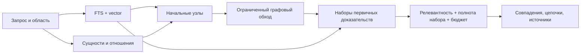
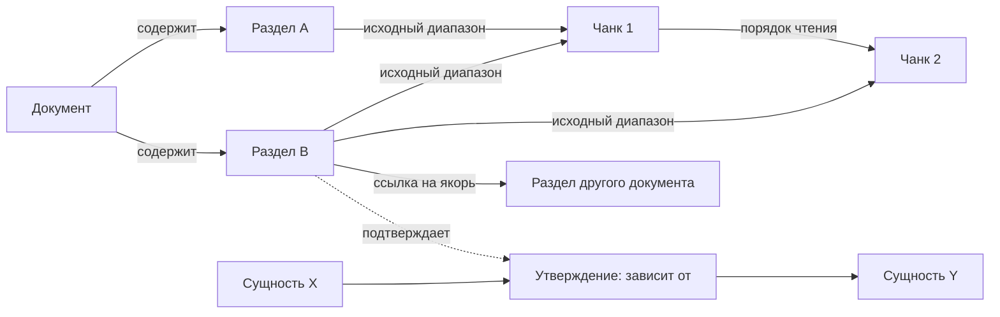

# Внедрение GraphRAG и графа документов и чанков в bars

Статус на 18-10-2026: продуктовый проект и исследование. Проверены текущие описания bars и первичные источники; сценарии и контракты ниже — предложения, не результаты работающего GraphRAG. Реализация, мокап, установка библиотек и замеры не выполнялись.

Поручение автора: сначала обосновать пользу GraphRAG и несколько конкретных сценариев; затем спроектировать инструменты, изменения текущего поиска и графический просмотр документов/чанков. Архитектура следует после этих разделов. Пожелание — IDEA-11 в [реестре](../backlog/ideas.md); сравнение семейств алгоритмов — в [обзоре GraphRAG](graph-knowledge-retrieval.md).

## Зачем GraphRAG нужен bars

**Целевая польза — находить связанный набор знаний о задаче: отношения, цепочки, условия, решения и подтверждающие источники, разнесённые по документации.** Человек получает объяснимую навигацию по проекту; агент — более полный контекст для работы и меньше ручных переходов между поисками. Экономия времени/токенов и рост полноты — гипотезы для проверки, не измеренные преимущества.

[Текущий поиск](../features/search/hybrid-search.md) отбирает чанки по словам и смысловой близости, сливает ранги и при включённом rerank переоценивает фрагменты относительно запроса. Он уже способен находить все нужные документы; проблема — отсутствие явного отбора связанного набора и проверки, какие роли в этом наборе покрыты. По умолчанию короткая выдача также не обязана представить все части сложной задачи.

Пример: описание настройки может быть очень релевантно запросу, но не содержать ограничения, принятого решения и способа проверки. Другие документы могут почти не повторять слова запроса. Граф добавляет основания перехода: «описывает требование», «использует», «зависит от», «заменяет», «проверяет». Нужные фрагменты выбираются с учётом этих отношений и их источников.

**Связи документов и чанков дают адресацию и навигацию; смысловые отношения дают новые поисковые операции; GraphRAG использует их при отборе контекста.** У этих частей самостоятельная польза. Карта гиперссылок полезна без моделей, но сама по себе не делает поиск зависимостей или обзор всех тем.

| Для кого | Изменение рабочего процесса | Предлагаемый полезный результат |
|---|---|---|
| Автор проекта | От поиска отдельных описаний к проверке связанных решений и последствий | Видимые зависимости и источники, которые стоит пересмотреть |
| Участник проекта | От чтения дерева файлов к переходам между понятиями | Понятное устройство темы и точные места в документах |
| Агент | От серии поисков и догадок о достаточности контекста к набору источников с ролями | Требования, решения, ограничения и проверки с объяснёнными связями |

Основание направления: [Microsoft Local Search](https://microsoft.github.io/graphrag/query/local_search/) соединяет графовые сведения с исходными text units; [Global Search](https://microsoft.github.io/graphrag/query/global_search/) использует сообщества для охвата корпуса; [HippoRAG](https://github.com/OSU-NLP-Group/HippoRAG) разделяет retrieval и QA. Это подтверждает механизмы. Предлагаемые инструменты bars, их UX и выдача без генерации ответа — собственный проект, не готовые функции этих библиотек.

## Конкретные сценарии пользы GraphRAG

Сценарии S1–S8 — целевой охват исследования. Он не сужается до одного пилота. Примеры ожидаемых результатов иллюстративны: перечисленные смысловые рёбра ещё не извлечены и не проверены инструментом. Ссылки на реальные документы подтверждают материал для сценария, но не качество будущего retrieval.

### S1. Влияние изменения требования или правила

**Запрос:** «Меняем правила согласия на переиндексацию. Какие описания и проверки нужно пересмотреть?»

**Сейчас:** найти переиндексацию, прочитать результаты, вручную искать последствия по терминам каждого документа. Высокое место в поиске не означает зависимость от изменяемого правила.

**Предлагаемый результат:** список затронутых объектов с путями от требования, отдельно зависимости и обычные ссылки; ссылки на точные фрагменты. Материал bars: [диалог согласия](../features/window/reindex-consent.md), [протокол](../architecture/protocol.md), [локальные модели](../features/models/local-models.md), [трассировка Т-25](traceability.md). Их связи «описывает» уже заданы ссылками; `depends_on` и `verifies` требуют собственного основания.

**Польза и проверка:** полнота заранее размеченного набора затронутых описаний и доля лишних рекомендаций при том же бюджете чтения. Карта показывает документированное влияние, а не доказанное влияние на исполняемый код.

### S2. Поиск отношений и объяснение связи двух понятий

**Запросы:** «От чего зависит доступность поиска?»; «Как смена модели связана с диалогом согласия?»

**Сейчас:** поиск возвращает тематические абзацы; человеку/агенту приходится восстанавливать направление и условия отношений.

**Предлагаемый результат:** отношения субъект → предикат → объект и короткие пути между выбранными сущностями, с цитатой на каждом переходе. Например, описанное в документах изменение fingerprint → состояние `reindex_required` → действие пользователя; формальный тип каждого перехода должен быть подтверждён текстом, а не придуман из соседства.

**Польза и проверка:** правильность участников, направления, условий и всей цепочки. Одна неверная связь делает объяснение ненадёжным. Пустая выдача означает отсутствие пути в выбранном графе/бюджете, не доказанное отсутствие связи.

### S3. Полный контекст задачи для агента и нового участника

**Запрос:** «Собери контекст для изменения выбора устройства rerank: поведение, решения, ограничения и проверки».

**Сейчас:** несколько поисков по словам устройства/модели/настроек; найденные фрагменты могут повторять одно описание и пропускать другую роль.

**Предлагаемый результат:** ограниченный по токенам пакет источников по ролям: требования/поведение, решение, архитектура, исключения, проверка. Материал: [локальные модели](../features/models/local-models.md), [настройки](../features/settings/settings.md), [проверка устройств](../features/models/device-verification.md). Отсутствующая роль показывается как незаполненная; произвольный сосед не выдаётся за проверку.

**Польза и проверка:** покрытие необходимых ролей и фактов, дубли, число дополнительных поисков и объём прочитанного. Сравнение — с обычным поиском и увеличенным top-K при одинаковом общем бюджете. Само наличие файла проверки не означает, что все платформы физически приняты.

### S4. Поиск условий, исключений и отрицаний

**Запросы:** «Когда смена модели не требует переиндексации?»; «Какие ограничения относятся к GPU, а какие к CPU?»

**Сейчас:** тематически похожие абзацы с противоположными условиями могут оказаться рядом. Агент вручную сопоставляет платформу, роль модели и исключения.

**Предлагаемый результат:** утверждения с квалификаторами: embed/rerank, платформа, устройство, версия, отрицание; рядом исходные формулировки и область применимости. Материал — [контракт моделей](../features/models/local-models.md) и [диалог согласия](../features/window/reindex-consent.md).

**Польза и проверка:** меньше ошибочного переноса условия между разными объектами. Проверять отдельно отрицание, область условия и намеренно похожие противоположные примеры. Это сложный extraction-сценарий; граф без квалификаторов способен ухудшить результат.

### S5. Эволюция решений и выбор актуального основания

**Запрос:** «Почему выбран этот способ хранения; чем он отличается от ранее рассмотренных вариантов?»

**Сейчас:** поиск может вернуть исследование, действующий архитектурный документ и старую запись сессии. Релевантность не определяет их нормативный статус.

**Предлагаемый результат:** текущее решение с источником статуса, связанные альтернативы и аргументы; при явно записанной замене — цепочка `supersedes`. Материал — [стек](../architecture/stack.md), [исследование стека](stack-research.md), [ADR](../adr/Index.md). Не предполагается, что в корпусе уже есть любая желаемая цепочка замен.

**Польза и проверка:** правильный выбор текущего основания при сохранении доступа к истории. Дата новее не делает документ главным; статус решения и правила источника правды должны быть явными. При недостатке сведений показывается неопределённость, а не автоматический вердикт.

### S6. Обзор темы и всего корпуса

**Запросы:** «Какие направления оптимизации локальных моделей исследованы?»; «Какие основные темы и ограничения есть у проекта?»

**Сейчас:** top-K может заполниться близкими фрагментами одной популярной темы, даже если выдача состоит из хороших совпадений.

**Предлагаемый результат:** группы тем, представляющие документы/чанки, связи и пробелы покрытия. Материал — [база знаний](Index.md) и документы моделей/скорости/памяти. Сообщества помогают выбирать представителей разных областей; группировка не объявляется авторской классификацией.

**Польза и проверка:** охват размеченных тем, разнообразие и доля нерелевантных представителей. Сравнить с простым отбором по модулям и кластеризацией embeddings: если они дают тот же результат дешевле, генеративные отчёты не обоснованы. Готовый литературный ответ bars не генерирует.

### S7. Поиск источника через промежуточные понятия

**Запрос:** «Какие ограничения моделей могут повлиять на отзывчивость индексации?»

**Сейчас:** запрос может хорошо находить общий текст об индексации, но не источник, сформулированный через длину входа, batching или очередь к модели.

**Предлагаемый результат:** релевантный стартовый фрагмент → связанные понятия/отношения → дополнительный источник, с объяснением включения. Материал — [поиск при индексации](search-during-indexing.md), [локальные модели](../features/models/local-models.md), [воркер](../architecture/worker.md). Связь должна быть описана или извлечена с evidence; похожесть тем не становится причинностью.

**Польза и проверка:** обнаружение нужных источников, отсутствующих в обычном top-K, и цена добавленных ошибочных переходов. Здесь особенно важно сравнить graph expansion с простым увеличением кандидатов и переформулировкой запроса.

### S8. Аудит связности документации и областей без опоры

**Запросы:** «Какие требования не имеют описанного способа проверки?»; «Какие документы изолированы или связаны только через оглавление?»

**Сейчас:** дерево и поиск помогают вручную проверять файлы, но не дают систематического обхода отношений и покрытия.

**Предлагаемый результат:** изоляты, битые ссылки и цели якорей; отдельно — требования без найденной связи с проверкой и кандидаты на конфликт утверждений. Материал — [трассировка](traceability.md) и типы документов проекта. Для смысловой проверки требуется достаточное покрытие extraction.

**Польза и проверка:** правильность найденных структурных дефектов и доля подтверждённых смысловых пробелов. Изолят не означает ненужный документ; «проверка не найдена» не означает «проверки нет». Обнаружение противоречий — сопоставление условий и источников, а не автоматическое следствие наличия графа.

### Где GraphRAG не даёт автоматического выигрыша

Точный запрос «где описан `settings.toml`?» уже хорошо соответствует гибридному поиску. Для соседних абзацев достаточно структуры документа; для backlinks — индекса ссылок; для графа файлов — renderer и структурных рёбер. GraphRAG оправдывается, когда связи помогают найти недостающие источники или покрыть несколько частей задачи. Он добавляет цену extraction, обновления, хранения и обхода; ошибочные aliases/отношения могут снижать качество.

## Проект новых инструментов bars

Состав — шесть пользовательских операций: отношения, пути, влияние, контекст задачи, обзор темы и навигация по графу. Ни одна операция не реализована; названия/поля — предлагаемый контракт. MCP возвращает структурированные данные, CLI — тот же результат в JSON/тексте, окно — соответствующее представление. Выполнение общее, в воркере.

| Операция | Предлагаемое имя | Что получает пользователь | Сценарии |
|---|---|---|---|
| Поиск утверждений | `bars_relations` | Кто с кем связан, каким отношением и на каком основании | S2, S4, S5 |
| Объяснение связи | `bars_paths` | Несколько коротких доказательных цепочек | S2, S7 |
| Влияние изменения | `bars_impact` | Зависимые описания, причины включения и границы охвата | S1, S8 |
| Контекст задачи | `bars_context` | Набор источников по ролям в общем бюджете | S3, S4, S7 |
| Исследование темы | `bars_explore` | Темы, представители и связи без готового ответа | S5, S6, S8 |
| Работа с картой | `bars_graph` | Глобальный/локальный подграф на выбранном уровне | Все сценарии |

Разделение контекста и обзора намеренное: контекст выбирает необходимые роли одной задачи, обзор обеспечивает широту нескольких направлений. Простая выдача ближайших чанков не закрывает ни один контракт. Инструменты могут использовать общие алгоритмы; `bars_impact` внутри может быть пресетом обхода, сохраняя отдельное понятное действие для пользователя.

### bars_relations: отношения с условиями и первоисточниками

**Вход:** `query` либо `entity_ref`, predicates, направление, qualifiers, область, limit. Например: «от чего зависит поиск», predicate `depends_on`. Если имя неоднозначно, вернуть кандидатов сущности, а не объединять их.

**Выход:** субъект/предикат/объект, polarity, условия, статус явного/извлечённого утверждения, список evidence с document revision и строками. Отдельно — совпадение запроса и статус проверки источника. Пример формы: `A → depends_on → B; условие: …; источник: path:строки`. Число модели не называется вероятностью истинности.

### bars_paths: объяснение связи двух объектов

**Вход:** from/to refs, допустимые predicates, max hops/paths, budgets и область. Поиск по текстовым именам сначала разрешает обе стороны в IDs.

**Выход:** упорядоченные рёбра, evidence каждого перехода, совпадение квалификаторов и причина отбора. Различать смысловой путь и путь из гиперссылок. Возвращать несколько ограниченных альтернатив, а не все возможные пути. Источники открытия доступны отдельно по каждому шагу.

### bars_impact: карта документированного влияния

**Вход:** объект или набор объектов, описание предполагаемого изменения опционально, профиль связей и глубина. По `depends_on` обход для влияния идёт к зависимым объектам; `links_to` показывается отдельной категорией соседства.

**Выход:** затронутые описания/решения/проверки, путь от изменяемого объекта, прямое/косвенное влияние, условия применимости. При переданном описании изменения фильтрация по его смыслу — отдельная модельная операция с учётом цены; первый вариант может обходить зависимости без неё. Результат — рекомендации проверки документации, не список гарантированно сломанных файлов кода.

### bars_context: пакет источников для задачи

**Вход:** `query`, профиль задачи, роли источников, общий token budget, область, graph budget. Пример ролей: requirement/decision/behavior/constraint/verification; пользователь может задать подмножество.

**Выход:** роли и связанные источники, citations, причина включения, использованный бюджет, дубли/пустые роли и coverage. Один источник может покрыть несколько ролей; один громоздкий документ не должен вытеснить все остальные. Отбор сохраняет минимальные связные наборы evidence. Токены считать выбранным tokenizer либо явно помечать оценку; точность бюджета нельзя обещать без выбранного метода.

Иллюстрация пакета: «поведение → local-models; настройки → settings; проверка → device-verification», с конкретными фрагментами вместо пересказа. Это не утверждение, что весь контекст задачи уже собран этими тремя файлами.

### bars_explore: карта темы и покрытие корпуса

**Вход:** `topic` либо весь разрешённый корпус, уровень детализации, scope и бюджет. Операция работает по готовым communities/группам и первичным источникам; дорогое обогащение запускается отдельным явным действием.

**Выход:** группы с темами/сущностями, представляющие источники, межгрупповые связи, объяснение покрытия и доступное продолжение. Названия групп могут быть извлечены из исходных терминов; модельные названия/отчёты отмечаются производными. Группы по одному seed не подписываются обзором всего проекта.

### bars_graph: данные для общего и локального просмотра

**Вход:** view documents/sections/chunks/entities/mixed, root refs, depth, типы рёбер, направление, scope, budgets/cursor. Начальные объекты можно получить из любого другого инструмента.

**Выход:** узлы, рёбра, группировка документов, evidence refs, продолжение и снимок. Та же операция покрывает backlinks, окрестность и раскрытие документа. Координаты пользовательской раскладки не участвуют в поисковом ранге.

### Общий контракт инструментов и расширение существующих

Все ответы: scope, snapshot/generation, coverage, применённые параметры, `truncated/limit_reason`, доступное продолжение. Пустая выдача, непостроенный слой, устаревшая ссылка, неоднозначная сущность и исчерпанный бюджет — разные состояния. Evidence должно оставаться читаемым при клике; при смене исходника возвращается отметка устаревания.

`bars_rag_search` получает явный режим retrieval и объяснение включения источников; подробности — в разделе изменения поиска. `bars_status` показывает покрытие структурного/смыслового слоя, очередь, поколения и ошибки extraction. Существующие `bars_read`/`bars_outline` остаются способом прочитать и проверить оригинал. Новые инструменты не скрывают загрузку моделей или перестройку графа за обычным read-only запросом.

## Как изменится текущий поиск bars

### Текущий поиск: проверенный документальный baseline

По [контракту гибридного поиска](../features/search/hybrid-search.md): FTS5 и точный vector search → RRF → приоритет идентификаторов → отбор кандидатов для optional rerank → порог/лимит → чанки с путями/строками и типом оценки. Документированные умолчания: 30 кандидатов каждого поискового канала, 15 для rerank, 3 результата с rerank или 5 без него. Фактические значения переопределяются настройками и вызовом; свежие численные оптимизации параллельных работ здесь не переоцениваются.

Baseline уже использует и слова, и смысл; утверждение «сейчас поиск только по словам» неверно. Но контракт не обещает найти пути и собрать все обязательные части многошагового объяснения. Rerank отдельного чанка не оценивает полноту всего набора источников.

### Три предлагаемых режима выдачи

| Режим | Для каких задач | Изменение поведения |
|---|---|---|
| `hybrid` — обычный | Точная справка, известный термин/идентификатор | Текущий контракт, оценки и пороги |
| `mix` — со связями | S1–S4, S7: вопрос с несколькими источниками | Общий пул текстовых и графовых кандидатов; основные совпадения и связанные доказательства |
| `graph` — отношения и цепочки | S2, S4, S5: важны предикат и направление | Объекты результата — assertions/paths и подтверждающие чанки |

На первом этапе режим выбирается явно; автоматический выбор требует проверки качества и видимого указания режима. Обзор S6 выполняется отдельным `bars_explore`, а не притворяется обычным top-K. Обычный поиск остаётся исходным умолчанием до подтверждённой пользы.

### Поиск со связями: от запроса до набора evidence

1. Применить project/modules/files и выбрать согласованный снимок. Ограничения действуют также на промежуточные узлы и evidence.
2. Получить текстовые seeds из FTS/vector, дополнительно найти сущности и утверждения по запросу. Не требовать точного имени: aliases и индекс отношений нужны для естественной формулировки.
3. До окончательного top-K раскрыть подходящие связи. Контекст раздела идёт по структуре; зависимости — по допустимым predicates; similarity включается как отдельный канал. Ограничить fan-out, глубину, посещённые узлы/рёбра и время.
4. Преобразовать найденные assertions/пути в первичные фрагменты. Снять дубли по source spans; не считать padding новым доказательством.
5. Сформировать кандидаты двух видов: отдельные совпадения и связанные наборы evidence. Сравнить объединение рангов каналов, BFS/PPR и отбор путей на одном корпусе.
6. Rerank использовать для релевантности текстов, а роль/полноту цепочки — для отбора набора. Закрепить необходимые evidence выбранного пути: нельзя показать заключение цепочки и выкинуть его основание только из-за меньшей похожести отдельного абзаца.
7. Применить общий бюджет и вернуть объяснение: почему включён каждый источник, через какой seed/путь, что усечено и какие роли не покрыты.



RRF по каналам — baseline, не доказанный лучший выбор. Обычный PageRank не заменяет query-seeded PPR. Число соседей, центральность `Index.md` и короткая длина пути не являются достаточным основанием высокого ранга.

### Что пользователь увидит в новой выдаче

Пример для «Как смена модели связана с согласием на переиндексацию?»:

- Основное совпадение: фрагмент правила смены модели с обычной релевантностью.
- Связанное доказательство: описанный переход состояния с ссылкой на исходник; указано, каким отношением он найден.
- Связанное поведение: фрагмент диалога/действия пользователя; показан путь от исходного объекта.
- Покрытие: какие необходимые переходы подтверждены, где extraction неполон и был ли исчерпан бюджет.

Это форма проектируемого результата, не экспериментальная выдача. В списке и графе выделение одного источника подсвечивает относящийся к нему путь. Для агента те же сведения передаются структурированно.

### Оценки, пороги и объяснение результата

В `hybrid` сохраняются существующие min_score и ограничения пользователя. В новых режимах нельзя молча снижать порог или приписывать графовому evidence оценку rerank стартового чанка.

Предложение отдельного контракта `mix`: канал основных совпадений сохраняет действующие оценки/пороги; связанный набор показывается как evidence выбранного отношения/пути со своим основанием включения, текстовой релевантностью, если посчитана, и отдельным общим бюджетом. Он не называется обычным совпадением, прошедшим прежний порог. При запрете дополнительных источников возвращается только основной канал и явная отметка неполной цепочки. Это проект нового режима, а не обход текущих настроек.

Для `graph` ранг отношения/пути имеет отдельный тип и не переводится в «процент истины». Порог уверенности extraction, релевантность запроса и проверенность факта различаются. Противоречащие утверждения сохраняются с условиями/статусом, не устраняются сортировкой.

### Что GraphRAG даст поиску и чего пока не доказано

Ожидается больше необходимых источников для составных вопросов, лучшее покрытие ролей контекста и тем, объяснимые переходы. Возможная цена — более высокая задержка и лишние источники из ошибочных связей. Выигрыш не предполагается для каждого запроса; измеряется отдельно по S1–S8 и на точечных контрольных запросах.

Неполный граф не должен незаметно маскироваться успешным graph search. В `mix` допустима текстовая выдача с явной отметкой недоступного/отстающего слоя. В `graph` отсутствие слоя показывается как недоступность операции, а отсутствие пути — как ограниченный результат поиска.

## Графический просмотр документов, чанков и смысловых связей

Цель просмотра — исследовать проект, выбирать область поиска, проверять основания отношений и передавать выбранные источники агенту. [Obsidian](https://obsidian.md/help/plugins/graph) — ориентир общего/локального графа, глубины, групп и фильтров; семантические отношения и chunk view bars проектируются отдельно.

### Представления одного графа и действия пользователя

| Вид | Узлы и связи | Рабочие действия | Связь со сценариями |
|---|---|---|---|
| Документы | Файлы; ссылки и отдельно агрегаты смысловых рёбер | Открыть файл, показать backlinks, раскрыть документ | Обзор проекта, S1/S5/S8 |
| Разделы/чанки | Разделы и retrieval-чанки разными типами; покрытие, порядок, ссылки | Перейти к строкам, раскрыть/свернуть документ, сравнить фрагменты | Контекст и точные доказательства, S3/S4/S7 |
| Сущности | Требования/компоненты/решения; типизированные assertions | Фильтр предиката, входящие/исходящие, поиск пути | Отношения и влияние, S1/S2/S4/S5 |
| Смешанный | Документы, чанки, сущности и evidence | Пройти от утверждения к оригиналу, выделить цепочку | Объяснение результата, S2/S3/S7 |
| Тематический масштаб | Свёрнутые сообщества как уровень общего графа | Раскрыть тему и её представителей | Широта исследования, S6 |

Документы и чанки — полноценные отдельные виды, а не необязательная надстройка графа сущностей. Тематический масштаб — дополнительный уровень общей карты. Переключение сохраняет выбранный объект, область и snapshot; при свёртке рёбра агрегируются по типу/направлению с доступом к исходным evidence. Количество повторов не выдаётся за число независимых подтверждений.

### Компоновка экрана графа

Проект экрана, не интерактивный мокап:

```text
Проект     Документы | Разделы/чанки | Сущности | Смешанный
Общий / Локальный    Поиск узла    Типы связей    Глубина
┌────────────────────────────────┬─────────────────────────┐
│ Карта, группы, выделенный путь  │ Узел / отношение        │
│                                │ Условия, статус         │
│ Раскрытие документа до чанков   │ Источники: файл, строки │
│                                │ Цитата, версия          │
│ Масштабирование и перемещение   │ Открыть оригинал        │
└────────────────────────────────┴─────────────────────────┘
Область · Покрытие · Ограничение выдачи · Представление списком
```

Клик выбирает объект; инспектор показывает его определение/связи или evidence ребра. «Открыть» ведёт в документ к строкам; «Раскрыть» переводит файл в группу его разделов/чанков. «Локальный граф» центрирует выбранный объект. Два выбранных узла → «Найти путь»; один → «Влияние изменения». Выделенный подграф → область поиска либо пакет `bars_context` с бюджетом.

Из обычной выдачи действие «Показать в графе» открывает источник вместе с найденным путём; возврат сохраняет запрос и фильтры. Граф не должен менять выбранную область поиска просто от перемещения камеры.

### Читаемость, доверие и состояния просмотра

Фильтры: модуль/файлы, тип узла/ребра, направление, статус утверждения и условия. Сходство и co-occurrence включаются отдельно от зависимостей; гиперссылка не подписывается «использует». Цвет/форма/стрелки имеют легенду, выбранный путь можно прочитать списком. Нужны клавиатура, фиксация узлов, остановка layout и reduced motion.

Большую карту открывать документами/сообществами и раскрывать локально, сохраняя доступ к общей картине. Предел показа обозначается честно: total только если известен; иначе сообщение об ограничении и продолжение. Не превращать лимит renderer в молчаливую потерю данных.

Состояния: граф не построен; нет связей; extraction догоняет индекс; неразрешённая ссылка; кандидат отношения без проверки; противоречащие evidence; путь усечён; источник изменён/удалён; renderer недоступен. Во всех случаях остаётся список доступных источников и видимая граница полноты.

## Технические основания продуктового проекта

Архитектура ниже обслуживает S1–S8 и описанные контракты. Её детали не заменяют доказательство пользы: хранение графа и красивый renderer сами по себе не означают улучшения retrieval.

## Что bars уже даёт для графового слоя

Основание — [схема индекса](../architecture/schema.md), [нарезка](../features/indexing/chunking.md), [обновление](../features/indexing/updates.md), [гибридный поиск](../features/search/hybrid-search.md), [MCP](../features/agent-tools/mcp-tools.md), [стек](../architecture/stack.md). Это сверка проектной документации, не аудит всех путей исполнения кода.

| Сейчас описано в bars | Что использовать | Чего пока нет в описанном контракте |
|---|---|---|
| `documents`: путь, модуль, title, хеш | Узлы документов, фильтры, версия исходника | Долговечная идентичность при переносе файла |
| `chunks`: документ, ordinal, строки, heading chain, embed hash | Retrieval и открытие найденного фрагмента | Стабильные внешние graph ID; отдельные узлы разделов |
| FTS5, нормализованные векторы, rerank | Поиск начальных узлов и ранжирование источников | Индекс отношений и графовый обход |
| Инкрементальная индексация и подмена SQLite | Обновление графа и согласованные снимки | Очередь extraction, происхождение рёбер, поколения графа |
| Worker → MCP/CLI; общие обработчики с Tauri | Одна реализация графовых операций | Новые DTO и команды графа |
| Svelte 5/TypeScript/Tauri | Компонент графа и инспектор источников | Renderer, layout, управление большим подграфом |

В текущей документации схемы версия — 1. Нельзя присвоить новую версию исследованием: её выбирают при миграции. Графовые таблицы — расширение индекса по Т-5; ограничения стека — Т-3; фильтры поиска — Т-14; обновления — Т-9/Т-10. Требования здесь не переписываются.

## Раздел и чанк должны быть разными объектами

По текущему алгоритму большой раздел режется на несколько чанков, маленькие разделы склеиваются, а короткому чанку иногда добавляется копия предыдущего текста. Следовательно, `Document → Section → Chunk` — полезная картинка, но недостаточная модель хранения.

Нужна связь **многие-ко-многим между разделами и чанками через исходные диапазоны**. Иерархия заголовков живёт в `sections`; нарезка retrieval — в `chunks`. Один чанк покрывает несколько разделов, один раздел — несколько чанков. Добавленный контекст отмечается отдельно от собственного текста. Ссылки и evidence извлекаются из исходного Markdown; иначе padding и добавленный список заголовков создадут дубликаты или ложное происхождение.



Схема иллюстративная: пунктирное ребро показывает происхождение утверждения. В графическом представлении утверждение может быть подписанным ребром X → Y; в хранилище evidence связывается с самим утверждением.

Номера строк — координаты конкретной ревизии, не долговечный ID. `ordinal` меняется после вставки раздела; embed hash содержит путь и не переживает переименование как идентификатор объекта. Одинаковые заголовки и повторённые абзацы также исключают ID только по тексту заголовка/хешу.

Предложение: ID документа сохраняется при уверенно обнаруженном переносе; при неоднозначности создаётся новый объект. Разделы сопоставляются по явным ID, если они есть, либо по структуре и содержимому; неоднозначное сопоставление не делается молча. Версия чанка адресуется в пределах поколения индекса. Старый результат либо разрешается явно в текущую версию с отметкой изменения, либо возвращает `stale_ref`. Обещание постоянных ссылок на чанки пока не принимать.

## Типы связей и источники зависимостей

| Тип | Направление и смысл | Как получить | Ограничение |
|---|---|---|---|
| `contains` / `parent_section` | Документ/раздел содержит раздел | Разбор ATX-структуры | Структура, не смысловая зависимость |
| `covers` / `next_chunk` | Покрытие диапазона / порядок фрагментов | Нарезка и source map | Не подменять последовательность зависимостью |
| `links_to` | Исходный раздел ссылается на документ/якорь | Markdown-ссылки | Не означает `depends_on` |
| `mentions` | В исходнике упомянута сущность | ID, aliases, extractor | Упоминание не доказывает отношение |
| `depends_on`, `uses`, `implements`, `verifies`, `supersedes` | Типизированное утверждение | Явная запись или extractor с evidence | Нужны направление, отрицание, условия и статус |
| `similar_to` | Семантическая близость | Top-k по embeddings с порогом | Не является фактом о зависимости |
| `co_occurs` | Совместное упоминание | Окно исходного текста | Не имеет предиката причинности |
| `member_of` | Принадлежность сообществу | Кластеризация выбранного слоя | Производная связь, зависит от версии алгоритма |

Не строить clique из всех чанков одного документа: принадлежность передаётся через документ/раздел, иначе число структурных рёбер растёт квадратично. Сходство считать ограниченными соседями; полный перебор всех пар имеет квадратичную цену и требует отдельного замера. Взаимность kNN — явная политика проекции.

Разбор ссылок: inline/reference Markdown links, относительные пути, `#fragment`, URL-encoding, ссылки на файл без якоря, повторы заголовков, неразрешённые ссылки. Ссылки внутри code fences не создают рёбра. Wiki-links `[[...]]` — отдельная поддержка после выбора синтаксиса; сходство интерфейса с Obsidian не утверждает её автоматически. Внешние URL можно показывать терминальными узлами без скачивания. Пути вне разрешённой области не становятся обходным чтением файлов. Ссылка из заголовка и ссылки reference-style требуют тестов разбора.

Для зависимостей три канала: явные структурированные отношения → извлечение из прозы → ручная проверка кандидатов. Обычная фраза «A зависит от B» требует различать отрицание, цитату старого решения и условие «только на Windows». Предлагаемый словарь предикатов ограничен; свободный текст отношения сохраняется рядом. Два источника могут поддерживать одно утверждение; противоречащие утверждения сохраняются с квалификаторами, не схлопываются в одно ребро.

## Хранение графа и происхождения в SQLite

Предложение логической схемы, не готовая миграция:

| Объект / таблица | Минимальные данные |
|---|---|
| `graph_meta` | Schema/extractor/predicate versions, active generation, coverage и состояние |
| `sections` | Document ID, parent ID, heading occurrence, исходные диапазоны, revision |
| `chunk_spans` | Chunk revision, section ID, исходные диапазоны, роль собственного/добавленного текста |
| `entities`, `aliases`, `mentions` | Project namespace, canonical ID/type, aliases; места упоминания с ревизией |
| `assertions` | Subject, predicate, object, polarity, qualifiers, статус кандидата/проверки |
| `evidence` | Assertion ID, document revision, точные spans/quote hash, extractor/config version, способ получения |
| `structural_edges` | Исходный объект, цель, тип, место ссылки; unresolved target без придуманной цели |
| `derived_edges` | Similarity/co-occurrence, метод, параметры и версия модели |
| `relation_search` | FTS-представление утверждения; опциональный embedding с собственным fingerprint |
| `communities` / membership / reports | Версия слоя, состав, первоисточники и состояние пересчёта |

Предпочтительны отдельные внешние ключи и таблицы для разных связей; если выбран универсальный `nodes`, его ID должен ссылаться на проверяемый typed object. Полиморфные `kind + id` без ограничений целостности оставляют висячие ссылки. Индексы нужны как по `(source, predicate)`, так и по `(target, predicate)`, плюс по document/revision и evidence. Координаты раскладки — пользовательское состояние, не факты графа.

[SQLite поддерживает recursive CTE и графовые обходы](https://sqlite.org/lang_with.html). Для первых ограниченных окрестностей подходит SQLite-выборка и BFS в Rust. [petgraph](https://docs.rs/petgraph/latest/petgraph/algo/) — кандидат для алгоритмов над выбранным снимком. Обычный PageRank не заменяет Personalized PageRank с query seeds. Нужность второй БД решать по замерам целевых запросов; наличие GraphRAG само по себе не обосновывает Neo4j.

## Обновление, удаление и согласованность графа

1. Читать документ одной ревизией; получить дерево разделов, source map и структурные ссылки. При публикации текста в той же транзакции снять устаревшие evidence этого документа. Новая версия текста не должна соседствовать с «текущими» доказательствами старого текста.
2. Поставить изменённые исходные диапазоны в фоновую очередь extraction. Ключ кэша включает содержимое, релевантный контекст, extractor/ontology/prompt version; совпадения одного embed hash недостаточно.
3. Перед записью extraction проверить revision. Если файл успели изменить — результат старой работы отбросить/пометить историческим, не публиковать текущим.
4. Удалить вклад исчезнувших упоминаний/доказательств. Утверждение с другими актуальными evidence сохранить. Рёбра без текущих доказательств исключить из текущего retrieval; ручные утверждения требуют собственного источника и правил хранения.
5. При изменении цели ссылки переопределить входящие ссылки и состояние якоря, включая источники, которые сами не изменились. Слияние aliases, смена extractor и кластеризация могут затронуть документы вне изменённого файла.
6. Публиковать поколение графа и coverage. Текстовый поиск работает, пока смысловой слой догоняет; графовый ответ сообщает об отставании. Полная перестройка публикуется только при согласованном состоянии выбранного режима.

Удобно различать `text_generation`, `graph_generation`, `extractor_fingerprint`, а для отчётов — `community_generation`. Запрос открывает согласованный снимок SQLite; UI отвергает поздние ответы старого поколения. Курсор пагинации привязан к снимку: нельзя собирать один путь из нескольких поколений. Перестройка графа без смены embeddings не должна автоматически перезапускать embedding всего корпуса. Существующие правила согласия на переиндексацию сохраняются по Т-25.

## Выбор GraphRAG-подхода для bars

Повторная интернет-проверка 18-10-2026; подробности семейств — в [обзоре](graph-knowledge-retrieval.md).

| Подход | Подтверждённый механизм | Роль в внедрении bars |
|---|---|---|
| [Microsoft Standard](https://microsoft.github.io/graphrag/index/methods/) | LLM извлекает/обобщает сущности и отношения, создаёт отчёты сообществ | Кандидат богатого смыслового слоя; учитывать цену первичной обработки и правок |
| [Microsoft Local](https://microsoft.github.io/graphrag/query/local_search/) | Отбор сущностей, отношений и связанных исходных text units | Ориентир retrieval вокруг сущности; выдача источников bars — собственная адаптация |
| [Microsoft Global](https://microsoft.github.io/graphrag/query/global_search/) | Map/reduce по LLM-отчётам сообществ | Поздний отдельный режим обзора; не простой поиск соседей |
| [FastGraphRAG](https://microsoft.github.io/graphrag/index/methods/) | NLP/co-occurrence, LLM-отчёты | Baseline тематического графа; не extractor направленных зависимостей; русский проверить |
| [LazyGraphRAG](https://www.microsoft.com/en-us/research/blog/lazygraphrag-setting-a-new-standard-for-quality-and-cost/) | Часть LLM-работы отложена до запроса | Вариант обогащения по потребности; стоимость/задержку запроса учитывать полностью |
| [LightRAG](https://github.com/HKUDS/LightRAG) | Retrieval сущностей/отношений и чанков | Близкий образец общего слоя; не прямая Rust-зависимость |
| [HippoRAG 2](https://arxiv.org/abs/2502.14802) | Граф фактов/passages и PPR; [код разделяет retrieve и rag_qa](https://github.com/OSU-NLP-Group/HippoRAG) | Сравнение multi-hop retrieval на одинаковых seeds |
| [PathRAG](https://arxiv.org/abs/2502.14902) | Отбор relational paths | Ориентир объяснимых путей и pruning |

Предлагаемый первый смысловой вариант: типизированные assertions с evidence, отдельный поиск отношений, bounded paths; после этого сравнить BFS/PPR/path ranking. Сообщества — целевой дополнительный слой, но не обязательная зависимость первого окна графа. Отчёты сообществ не использовать как единственное доказательство факта: первоисточники должны оставаться доступны.

В bars [генерация готового ответа исключена](../MAIN_IDEA.md#границы). Можно извлекать отношения моделью при индексации и отдавать графовый контекст агенту без изменения этой границы. Установка Microsoft GraphRAG/LightRAG как Python-сервиса конфликтует с Т-3; адаптация идей в Rust — отдельная реализация, не воспроизведение фреймворка.

Кандидаты extraction: правила по ID/явным отношениям; encoder GLiNER/GLiREL; локальная генеративная модель с ограниченной схемой. Их сопоставление и риски `ort` описаны в обзоре. Репозиторий gline-rs в повторной проверке этого исследования не открылся; совместимость конкретных checkpoints не подтверждена. Существующий embedder/reranker не считать готовым extractor. Для LLM нет выбранных модели, runtime и ресурсного бюджета; это отдельный опыт, а не уже доступная возможность.

### Библиотека отрисовки и раскладки

| Кандидат | Подтверждено источником | Цена и проверка для bars |
|---|---|---|
| [Cytoscape.js](https://js.cytoscape.org/) | MIT, compound nodes, типизированное оформление, события, layouts, JSON | Предпочтение для первого прототипа: чанки внутри документов. Проверить время layout, подписи, fan-out, потребление памяти |
| [Sigma.js](https://github.com/jacomyal/sigma.js) + [Graphology](https://github.com/graphology/graphology) | WebGL-renderer + отдельная graph-модель | Кандидат больших карт. Compound UX/инспектор/свёртка — продуктовая работа; layout не равен renderer |
| Собственный SVG/Canvas | Полный контроль небольшого примера | Подходит схеме в документе; собственные hit-testing, layout, доступность и масштабирование увеличат объём продукта |

Быстрая проверка поддержки 18-10-2026: страницы релизов показывают [Cytoscape.js 3.34.4](https://github.com/cytoscape/cytoscape.js/releases), [Sigma 4.0.3](https://github.com/jacomyal/sigma.js/releases); у Sigma 4 в notes описана переработка API. Это снимок, не закрепление версий и не рекомендация копировать старые примеры v3. У Cytoscape документация перечисляет пользователей и примеры compound graphs. Для выбранной версии отдельно проверить лицензию расширения layout и совместимость WebView2/WKWebView; производительность не установлена публикацией релиза.

Первый опыт: один и тот же набор узлов/рёбер в Cytoscape и Sigma; 100/1 000/5 000 чанков и разные степени узлов как тестовые размеры, не обещание вместимости. Мерить полное открытие экрана, время до первого кадра/готовности layout, реакцию выбора и pan/zoom, UI memory. Раскладку выполнять вне основного потока, где поддерживается, отменять устаревшие задачи, при закрытии уничтожать renderer/worker. Библиотеку поставлять с приложением, а не загружать через CDN во время работы.

## Этапы внедрения и точки проверки

Это предложение последовательности, не разрешение на реализацию и не календарная оценка.

| Этап | Изменение и результат | Зависимость / доказательство готовности |
|---|---|---|
| G0. Контракт и набор проверки | Документ фичи, словарь рёбер, source map/ID/снимки, HTML-мокап четырёх видов по OQ-63 | Согласованная семантика и независимые примеры; не начинать с неясного `depends_on` |
| G1. Структурный граф + окно | Разделы, chunk spans, ссылки/backlinks; общий/локальный документный граф и раскрытие чанков | Правки/удаления/якоря не оставляют старых рёбер; переход открывает точный исходник |
| G2. Смысловые связи | Assertions/evidence, extraction, aliases, `bars_relations`, инспектор связи | Качество предиката/направления/условий на русском; provenance и invalidation |
| G3. Пути и влияние | `bars_paths`, impact preset, смешанный граф | Все рёбра объяснимы; циклы/хабы/ограничения/области проверены |
| G4. Graph-assisted retrieval | Явный graph/mix, rank fusion, BFS/PPR/path comparisons | Выигрыш на удержанном multi-hop наборе при одинаковых seeds и бюджете |
| G5. Темы и глобальный обзор | Сообщества, карта крупных корпусов; опциональные отчёты | Пересчёт/отмена, покрытие тем, первичные источники и цена обогащения |

G1 даёт самостоятельную пользовательскую функцию; IDEA-11 остаётся открытой до выбранного целевого состава. Нельзя считать выполненным смысловой GraphRAG только потому, что нарисован граф Markdown-ссылок. G0/G1 умереннее по неопределённости; G2 — основной риск качества; G4/G5 — риск ресурсов и доказательства полезности. Сроки оценивать после спайков, не по названиям библиотек.

При реализации затрагиваются: `bars-core` (source map, схема, traversal/retrieval), `bars-worker` (очередь extraction, handlers, snapshots), `bars-protocol` (DTO/ошибки), `bars-mcp` и `bars-cli` (инструменты), `bars-app` (Tauri-команды), `ui` (экран, renderer, инспектор), инструкция/skills (когда пользоваться новыми инструментами). Это карта областей по текущей архитектуре, не список уже внесённых правок.

## Проверка качества и критерии продолжения

Структура и retrieval проверяются отдельно; красивые узлы не доказывают качество поиска.

- Фикстуры: одноимённые заголовки, склейка/дорезка/padding чанков, reference links, битый якорь, ссылка в коде, перенос и удаление цели. Для каждого ребра ожидается точный исходный диапазон.
- Обновления: правка только цели, удаление одного из двух evidence, исчезновение последнего evidence, смена extractor, правка во время extraction, отмена и перезапуск, ошибка отдельного файла. Старый snapshot не смешивается с новым.
- Смысл: размеченные субъект/предикат/объект, aliases, отрицание, условия, два разных объекта с одним именем, устаревшие ADR/цитаты. Precision/recall считать по отношениям и привязке к источнику; правдоподобие текста не заменяет метрику.
- Retrieval: обычный гибрид → структурное расширение → типизированный BFS → PPR → пути. Одинаковые seeds, документы, финальный rerank и бюджет контекста; дополнительно end-to-end вариант с entity/relation seeds. Метрики: полнота набора необходимых evidence, precision выданных источников, корректность пути, nDCG/Recall, усечение.
- Разделение development/holdout до выбора порогов/весов; сравнение с простым увеличением top-K при том же бюджете. Отдельно одношаговые задачи: граф не должен ухудшать их незаметно.
- Ресурсы: первичная обработка, одна правка, прогрев, полный p50/p95 запроса через worker, объём SQLite/моделей, RAM/VRAM, скорость UI и влияние на обычную индексацию/поиск. Нынешний search benchmark не подменяет graph benchmark.
- Продуктовая ручная проверка: документ → чанки → сущность → ребро → исходные строки; локальный/общий режим, путь, обе темы, клавиатура, остановка layout, неполный граф и удаление выбранного узла. Браузерная фикстура и реальный Tauri/worker фиксируются раздельно.

Переход к G4 обоснован, когда отношения достаточно точны и обновления корректны. Расширение до G5 обосновано задачами обзора всего корпуса и замером стоимости. Численные пороги качества/задержки выбрать по baseline и допустимому риску; это исследование не объявляет их выполненными.

## Нерешённые продуктовые развилки

Зафиксированы в [QUESTIONS.md](../../QUESTIONS.md), исследованию не мешают:

- **OQ-85:** режим смыслового extraction и вычислительный бюджет. Рекомендация — явное включение локального обогащения; неизвестные модели/стоимость не прятать в первую индексацию.
- **OQ-86:** авторские структурированные зависимости и ручная проверка связей. Рекомендация — сначала чтение Markdown + извлечённые кандидаты; формат записи отношений и право окна менять исходник проектировать отдельно.
- **OQ-87:** объединение проектов в одну карту. Рекомендация — первый граф в пределах проекта; межпроектные aliases и переходы требуют отдельного контракта.

Запрос автора уже включает граф документов и чанков; для исследования не требуется заново подтверждать эту потребность. Конкретные модели, формат ручной разметки и межпроектный граф автор не выбирал.

## Итог исследования и пределы доказательств

Технически обоснован путь: текущий индекс → исходные разделы/диапазоны → типизированные связи с evidence → общий/локальный граф четырёх видов → поиск отношений/путей → проверяемое графовое расширение контекста → сообщества. Новые инструменты и графический просмотр используют один слой данных и одни обработчики.

Внешние источники подтверждают механизмы и возможности библиотек; проектные документы подтверждают точки интеграции. Не установлены точность русского extraction, совместимость конкретной модели с текущим ONNX runtime, пределы renderer в Tauri и выигрыш GraphRAG на корпусе bars. Их проверка включена в этапы; реализация не начата.
