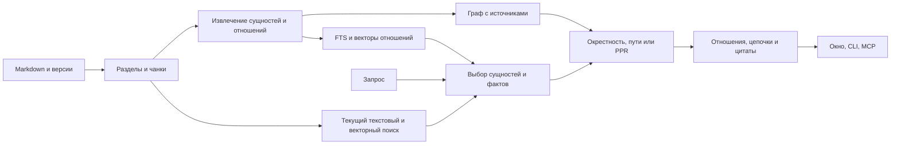

# Граф знаний, GraphRAG и отдельный поиск связей для bars

Исследование на 18-10-2026. Автор уточнил направление: graph, GraphRAG и отдельный поиск связей — очевидная часть желаемых интеллектуальных инструментов документации. Здесь разобраны retrieval-алгоритмы, локальное извлечение и варианты Rust-интеграции. [Дополнительный продуктовый обзор](graph-and-relations.md) разделяет визуальный граф, поиск отношений и графовое расширение контекста. [Предыдущий обзор](local-documentation-tools.md) полезен для вспомогательных действий, но не покрывает уточнённый запрос.

Статус: исследование механизмов и предложения агента, не протокол приёмки. Текущая частичная [реализация](../features/graphrag/Index.md) использует существующие embeddings, явные правила и SQLite; новая модель не добавлена. [Development-замеры и недостатки](graph-corpus-2026-10-18/Index.md) и [renderer/компонент](graph-renderer-2026-10-18/Index.md) отделены от этого обзора. Авторский запрос — IDEA-11 в [пожеланиях](../backlog/ideas.md).

## Главный вывод для bars

Продуктовый проект по поручению автора — [польза и внедрение GraphRAG](graph-integration-2026-10-18.md): восемь сценариев, шесть инструментов, изменения текущего поиска и графический просмотр документов/чанков; затем source map, обновления, хранение и этапы проверки. Три пробы нынешнего поиска отделены от ожидаемой пользы GraphRAG. Это исследование без реализации.

**Граф знаний и поиск отношений заслуживают отдельного направления, а не пункта «когда-нибудь большой GraphRAG».** Полезный результат — «сущность → отношение → сущность» с источником, цепочка между двумя понятиями, карточка объекта и подбор связанных доказательств через несколько документов. Рисунок графа — одно из представлений этих данных.

Наиболее подходящий кандидат для локального bars: **типизированный граф с подтверждающими фрагментами + отдельный индекс отношений + гибридный поиск текст/векторы/граф**. Дорогую обработку документов можно выполнять при изменении файла, а интерактивно искать по уже построенным структурам. Выгоду и задержку такого разделения ещё нужно измерить.

Полный GraphRAG также исследован: Microsoft Standard/Fast, LazyGraphRAG, LightRAG, HippoRAG 2, PathRAG и MiniRAG. Их названия не означают одинаковое устройство или одинаковую стоимость. Убирать генерацию ответа и заменять извлечение в исходном алгоритме — собственная адаптация, результат которой нельзя выдавать за воспроизведение статьи.

## Какие графы нужны и чем отличаются их связи

| Слой | Узлы и связи | На какой вопрос отвечает | Основание связи |
|---|---|---|---|
| Структура документации | Документ, раздел; `contains`, `links_to` | Где описано и что на это ссылается | Разбор Markdown |
| Граф совместных упоминаний | Термины, сущности; `co_occurs` | Что часто обсуждают вместе | Совпадение в выбранном контекстном окне |
| Граф семантической близости | Разделы/понятия; `similar_to` | Что похоже по содержанию | Embedding и алгоритм соседей |
| Граф знаний | Объекты/понятия; `depends_on`, `uses`, `replaces`, другие типы | Как именно связаны X и Y | Явная разметка, правило или модель извлечения |
| Граф происхождения | Утверждение, источник, версия, проверка | Откуда известно и к какой версии относится | Привязанный исходный фрагмент/запись проверки |

Совместное упоминание `Worker` и `Mutex` не говорит, кто чем владеет. Cosine не устанавливает `depends_on`. Гиперссылка не означает реализацию требования. Эти рёбра можно хранить вместе, но нельзя смешивать типы и основания. Графовая БД хранит/запрашивает связи; сама по себе она не извлекает их из прозы.

## Полезные инструменты над графом

Названия инструментов ниже — эскиз, не существующий MCP-контракт. Вопросы в таблице — примеры запросов к продукту, а не открытые вопросы автору.

| Инструмент | Пример пользовательского действия | Результат для человека и агента | Что нужно считать |
|---|---|---|---|
| **Поиск отношений** | «Что блокирует поиск?»; фильтр `depends_on` | Найденные отношения, направление, условия, исходные строки | Текстовый/векторный индекс описаний рёбер + фильтры |
| **Связь двух понятий** | «Как скачивание модели связано с очередью?» | Несколько коротких цепочек с доказательством каждого ребра | Seed-поиск сущностей + ограниченный поиск путей |
| **Карточка сущности** | Открыть `rerank` | Определения, aliases, входящие/исходящие отношения, ограничения, документы | Нормализация имён + выборка окрестности |
| **Составной поиск** | Найти инструкцию, требование и проверку одной возможности | Подграф и набор фрагментов, которые обычный top-K мог разделить | Гибридные seeds + обход/PPR + отбор источников |
| **Исследование темы целиком** | «Какие направления есть у локального инференса?» | Группы сущностей, представители, подграфы; опционально обзоры | Сообщества и агрегирование по всему графу |
| **Условия и исключения** | «Где это разрешено только на CPU?» | Отношения с платформой, версией, отрицанием и исключениями | Извлечение утверждений с квалификаторами |
| **Карта влияния** | Выбрать изменённое понятие/API | Зависимые сущности и документы, пути зависимости | Обратный обход только подходящих типов связей |
| **Эволюция решения** | «Чем заменили этот подход и почему?» | Цепочка `supersedes/replaces`, основания и версии | Явные ADR/ID, история утверждений |
| **Неочевидные мосты** | «Что соединяет эти две темы?» | Общие посредники и пути с объяснением | Пересечение окрестностей, поиск мостов, ограниченное ранжирование |

«Магия» здесь — возможность искать отношения и цепочки, даже когда нужный ответ разнесён по документам. Достоверность цепочки ограничена качеством извлечения и разрешения сущностей. Кратчайший путь не обязан быть полезным объяснением, а путь из нескольких корректных связей не автоматически доказывает новую причинную связь.

## Отдельный поиск отношений — самостоятельный индекс

Предложение: индексировать не только чанки, но и представления утверждений. Минимальная запись — субъект, предикат, объект, направление, условия, источник и версия. Например, условный факт `индексация — использует → модель` хранится отдельно от абзаца, где он найден; это иллюстрация формата, не установленный факт реализации bars.

Возможные режимы:

1. **По типу и участнику:** все исходящие `uses` у выбранного объекта; все входящие `depends_on`; без нового инференса, если ID известен.
2. **По формулировке отношения:** FTS и векторный поиск по записи вида «субъект | предикат | объект | условия». Так запрос «чем ограничена скорость» ищет утверждения, а не только тематически похожие абзацы.
3. **Между двумя объектами:** выдача прямых отношений и путей с ограничением глубины, типов и числа результатов. Отдельно — отсутствие найденной связи и доказанное отсутствие зависимости: второе из неполного графа не следует.

Такой подход к поиску по триплетам есть в [HippoRAG 2, §3.3–3.5](https://arxiv.org/pdf/2502.14802): query-to-triple используется для выбора входа в граф. В статье также есть LLM-фильтрация триплетов и PPR с участием passages. Предлагаемый bars-режим без LLM-фильтрации — упрощение для проверки, а не готовый HippoRAG 2.

База для ранжирования: совпадение участников/типа, релевантность описания отношения, качество привязки к источнику, ограничения платформы/версии. Оценка extraction-модели не является вероятностью истинности. Исходный абзац показывается вместе с отношением.

## GraphRAG: что подтверждают первичные источники

### Microsoft GraphRAG Standard: сущности, отношения, сообщества

[Методы индексации](https://microsoft.github.io/graphrag/index/methods/) описывают извлечение и обобщение сущностей/отношений моделью, затем отчёты по сообществам. Это полноценное представление знаний, а не граф Markdown-ссылок. Строительство такого индекса включает много модельных операций.

[Local Search](https://microsoft.github.io/graphrag/query/local_search/) выбирает сущности, связи и исходные фрагменты для контекста вокруг запроса. [Global Search](https://microsoft.github.io/graphrag/query/global_search/) использует отчёты сообществ и map/reduce для вопросов по корпусу целиком. Их локальность/глобальность относится к охвату данных. Стандартный путь генерирует ответ; он не равен дешёвому офлайн-поиску.

**Применимость к bars:** заимствовать разделение entity/context retrieval и общего обзора; сохранять связь с текстом. Полный конвейер — отдельный кандидат с измерением стоимости построения, обновления и запроса.

### FastGraphRAG: совместные упоминания вместо богатых отношений

В [FastGraphRAG](https://microsoft.github.io/graphrag/index/methods/) часть LLM-извлечения заменена NLP-фразами и co-occurrence. Отчёты сообществ всё ещё генерирует LLM. Документация предупреждает о более шумном графе и английской направленности стандартного NLP-пути.

**Применимость к bars:** быстрый концептный граф — разумный baseline и способ исследования тем. Но это не готовый ответ на «кто кого блокирует»: `co_occurs` не даёт предикат/направление. FastGraphRAG и LazyGraphRAG — разные методы.

### LazyGraphRAG: часть затрат переносится на запрос

[Исследование Microsoft](https://www.microsoft.com/en-us/research/blog/lazygraphrag-setting-a-new-standard-for-quality-and-cost/) строит концепты и co-occurrence без предварительных LLM-обзоров. Однако уточнение запроса, оценка релевантности и сбор утверждений используют LLM во время поиска. Поэтому дешёвая индексация не означает быстрый интерактивный запрос.

**Применимость к bars:** исследовать ленивое обогащение только востребованного подграфа и бюджет обработки. Собственный режим «обогатить тему в фоне» возможен как предложение. Не считать публикацию готовым Rust-пакетом: страница отдельно указывает интеграции Microsoft Discovery/Azure Local; переносимость в bars не проверена.

### LightRAG: сущности и отношения ищутся раздельно

[Официальный репозиторий LightRAG](https://github.com/HKUDS/LightRAG) документирует `local`, `global`, `hybrid`, `naive`, `mix`, а также отдельные роли моделей для извлечения, keywords и ответа. [Статья](https://arxiv.org/abs/2410.05779) — первичный источник двухуровневого retrieval.

**Применимость к bars:** раздельный поиск сущностей/отношений плюс привычные чанки особенно близок запросу автора. Но прямой перенос фреймворка добавляет Python и другие контуры хранения; он не выбран. Убрать генерацию ответа возможно на уровне собственного retrieval-дизайна, но обработку естественного запроса и keywords также надо спроектировать. Название Light не доказывает задержку на CPU автора.

### HippoRAG 2: ассоциативный поиск через Personalized PageRank

[Статья HippoRAG 2](https://arxiv.org/pdf/2502.14802) связывает phrases, passages и извлечённые факты; по запросу выбираются seeds для PPR. [Репозиторий](https://github.com/OSU-NLP-Group/HippoRAG) отдельно описывает `retrieve` и `rag_qa`: retrieval и генерация действительно могут быть разными действиями.

**Применимость к bars:** полезен как образец multi-hop извлечения документов и перехода от найденного отношения к другим источникам. PPR сам по себе не требует генеративной модели, но оригинальная система включает OpenIE и recognition memory; их удаление меняет метод и качество.

### PathRAG: цепочки как результат поиска

[Статья PathRAG](https://arxiv.org/pdf/2502.14902) и [официальный код BUPT-GAMMA](https://github.com/BUPT-GAMMA/PathRAG) рассматривают отбор ключевых relational paths с flow-based pruning и передачу путей в prompt. Это сильный ориентир для самостоятельного инструмента «как X связан с Y».

**Применимость к bars:** возвращать пути как структурированный результат с источниками, а не разворачивать всю окрестность в текст. Алгоритмическая оценка пути — приоритет выдачи, не доказательство истинности. Самая короткая цепочка, top-N цепочек и pruning должны сравниваться на одном корпусе; все простые пути перечислять нельзя без жёстких лимитов.

### MiniRAG: граф для малых моделей

[MiniRAG](https://github.com/HKUDS/MiniRAG) предлагает heterogeneous graph и retrieval, ориентированные на small language models. Это полезная ветка для ограничения вычислительного бюджета, которую прежний обзор пропустил.

**Применимость к bars:** исследовать совместный граф сущностей и чанков, а не выбирать только между «совсем без моделей» и большой LLM. Заявления авторов о преимуществах малых моделей не заменяют проверку русского корпуса, текущего Rust runtime и конечной задержки.

## Сопоставление стоимости подходов

Относительная инженерная оценка агента, не бенч. «Без генерации» относится только к указанной стадии; extraction, query embedding и другие модели считаются отдельно.

| Вариант | Построение | Интерактивный поиск | Качество/главный риск |
|---|---|---|---|
| Явный typed graph | Правила, ID, разметка, ручные отношения | По ID/типу/пути без модели | Точность возможна, полнота зависит от разметки |
| Co-occurrence/концептный граф | NLP/словарь + совместные упоминания | Поиск seeds + обход | Нельзя выдавать соседство за типизированное отношение |
| Encoder NER + relation extraction | Локальная модель на изменённых текстах | Готовые рёбра; embedding для свободного запроса по необходимости | Нормализация сущностей, отрицания, русский технический язык |
| Генеративный extractor | Локальная LLM на документах | Retrieval может обходиться без генерации ответа | Стоимость построения, придуманные/потерянные факты |
| Standard GraphRAG Global | Извлечение + обзоры сообществ | LLM map/reduce | Хороший кандидат для глобальных вопросов; дорогое обновление и запрос |
| Lazy-подход | Меньше предварительной генерации | Больше обогащения/проверок по запросу | Задержка и повторные запросы к модели |
| PPR/path retrieval | Нужен граф и привязка фактов к chunks | Алгоритм + исходный поиск seeds; модели опциональны в адаптации | Хабы, шумные рёбра и ограничение пути |

Выбор между вариантами не следует из количества документов. Даже маленький корпус может требовать нескольких шагов связи; большой может состоять из независимых инструкций, где обычный поиск лучше.

## Построение графа локально: извлечение сущностей и отношений

### Явные сущности и типизированные связи

Начальные типы для технической документации: компонент, API, настройка, модель, платформа, требование, решение, проверка. Это пример схемы, не утверждённая онтология. ID, пути, таблицы и явно заданные зависимости дают начальный граф без новой модели. Словарь aliases можно использовать и для привязки вхождений к сущностям.

Важно разнести определение сущности, её упоминание и утверждение о ней. Два одинаковых слова «модель» могут обозначать embed и rerank; автоматическое слияние по имени испортит пути. Автоматическое предложение слияния — отдельно от подтверждённого canonical ID.

### Небольшие encoder-модели: GLiNER, GLiREL, GLiNER2

[GLiREL](https://github.com/jackboyla/GLiREL) классифицирует задаваемые типы отношений при известных сущностях. Это показывает отдельный контур relation extraction; NER сам по себе отношений не даёт. Исходная библиотека Python, готовность русского runtime из этого не следует.

[GLiNER2](https://github.com/fastino-ai/GLiNER2) документирует schema-conditioned извлечение, включая отношения, и английские/многоязычные checkpoints. Проверены карточки [gliner2-multi-v1](https://huggingface.co/fastino/gliner2-multi-v1) и [gliner2.5-multi-v1](https://huggingface.co/fastino/gliner2.5-multi-v1). Слово multilingual не подтверждает нужную точность на русской инженерной документации. ONNX-экспорт и поддержка всех голов конкретного checkpoint в bars не проверены.

Особенно релевантная находка — [gline-rs](https://github.com/fbilhaut/gline-rs): Rust inference для ONNX GLiNER, README заявляет готовые pipeline NER и relation extraction. Это конкретный кандидат для изучения совместимости, а не доказанная интеграция. Нельзя автоматически считать, что он запускает GLiNER2/2.5: README описывает определённые span/token модели; поддержка нового семейства не установлена. Проверить веса, токенизацию, heads, версию `ort`, CPU/DirectML и лицензию checkpoint. Скоростные обещания на этой основе не делаются.

### Генеративное извлечение в фоне

Локальная LLM может извлекать более свободные отношения, условия и определения. Так устроены многие исследованные graph-RAG конвейеры. Для bars это кандидат с более высокой стоимостью: schema-constrained вывод, проверка привязки к источнику, обработка изменившегося чанка и измерение ресурсов. Не требуется генерировать ответ пользователю, чтобы использовать извлечённые факты в retrieval.

Рекомендуемое сравнение: явные правила → encoder extractor → локальная генеративная модель на одном размеченном наборе. При оценке учитывать не только найденные имена, но предикат, направление, отрицание и область действия условия. Переход к LLM не даёт автоматической гарантии полноты/истинности.

## Предлагаемое устройство графового слоя bars

Это эскиз для обсуждения и опыта, не ADR и не изменение текущей схемы.

Минимум данных:

- **Entity:** стабильный ID, тип, canonical name, aliases/namespace.
- **Mention:** entity ID, document/chunk, диапазон исходника, версия.
- **Assertion:** subject, predicate, object, polarity, условия/платформа/версия, статус извлечения.
- **Evidence:** assertion ID, исходный фрагмент, хеш, способ/версия extractor. Одно утверждение может иметь несколько источников.
- **Derived edge:** сходство, co-occurrence или алгоритмический вывод с явным типом происхождения. Не подменяет assertion.

При изменении документа пересчитываются его вхождения/подтверждения. Удаление источника не должно удалять утверждение, подтверждённое другими документами, и не должно оставлять старое подтверждение текущим. Слияние aliases и обновление общих описаний затрагивают больше одного документа. Для query нужен согласованный снимок текста, векторов и графа.

## Хранилище и алгоритмы: варианты для Rust

| Вариант | Подтверждённый механизм | Для какого опыта подходит | Цена/ограничение |
|---|---|---|---|
| [SQLite recursive CTE](https://www.sqlite.org/lang_with.html) | Рекурсивный обход и примеры графовых запросов | Таблицы entities/assertions/evidence, ограниченные окрестности | Собственные ограничения обхода/циклов; не обещание быстрых произвольных graph queries |
| [petgraph](https://docs.rs/petgraph/latest/petgraph/algo/) | Алгоритмы путей, компонент, PageRank и другое | Подграф в памяти, поиск путей, базовые сравнения | Нужны загрузка и синхронизация с индексом. Обычный `page_rank` не автоматически PPR с query seeds |
| [Oxigraph](https://github.com/oxigraph/oxigraph) | Rust RDF/SPARQL, библиотечный вариант | Когда нужен декларативный язык запросов и RDF-модель | Новое хранилище/модель; README предупреждает, что SPARQL evaluation ещё не оптимизирована |

Собственная маленькая adjacency-структура также допустима для ограниченного опыта. GraphRAG не требует Neo4j. Выбор сервера/формата до проверки нужных запросов преждевременен. Новая зависимость должна пройти отдельную проверку сборки, поддержки и совместимости с существующим runtime.

## Что означает «быстро локально» для графа

Отделять четыре времени: первичное построение; обработка правки; прогрев; запрос. Рядом учитывать объём моделей, память, размер графа и число рёбер, а не только число чанков.

- Выборка отношений по известному entity ID может обходиться без модели.
- Запрос естественным языком может потребовать embedding, NER/intent или LLM разбор; этот шаг нельзя скрывать за временем обхода.
- Ограниченный BFS стоит порядка O(V+E) для посещённого подграфа; итерационный PPR — порядка O(I·E) в простом представлении. Это ориентиры алгоритма, не результат IPC/UI бенча.
- Степень хабов и перечисление путей способны сделать «маленький локальный граф» дорогим. Нужны пределы глубины, числа рёбер/путей и явная отметка усечения.
- Кластеризация и отчёты тем — отдельная фоновая работа. Её обновление может затронуть сообщества за пределами изменённого документа.

Локальная обработка не означает отсутствие вычислительной цены. Цель исследования — найти хороший баланс, а не исключать модели или графовые методы заранее.

## Смежные интеллектуальные направления, которые тоже стоило исследовать

**Иерархический retrieval.** [RAPTOR](https://arxiv.org/abs/2401.18059) строит дерево через embeddings, кластеризацию и рекурсивное обобщение. Даёт поиск на разных уровнях: от конкретного фрагмента до темы. Это не граф типизированных отношений; summaries требуют генерации и пересчёта. Для bars кандидат на тематическое исследование корпуса, а не замена отдельного поиска связей.

**Late interaction и несколько векторов.** [ColBERT](https://github.com/stanford-futuredata/ColBERT) сопоставляет запрос и документ через token-level representations. Направление полезно для точных технических деталей, которые теряются в одном векторе. Это другой retrieval, не knowledge graph; цена индекса/памяти и мультиязычное качество требуют проверки.

**Обогащение графа по потребности.** Начать с сущностей/явных отношений, постепенно уточнять востребованные области и сохранять результат. Это предложение для bars, вдохновлённое lazy-подходами, а не заявление о готовой функции конкретного фреймворка. Возможны отдельные действия «исследовать тему» и «найти по готовому графу», с разной ценой.

## Как проверить, что граф помогает

Нужен отдельный корпус graph-retrieval задач; обычный бенч первого релевантного чанка недостаточен. Предлагаемые категории:

| Категория | Что должно быть размечено | С чем сравнивать |
|---|---|---|
| Прямое отношение | Субъект, предикат, объект, источник | Обычный поиск + запрос по индексированным рёбрам |
| Multi-hop | Нужные рёбра и все исходные фрагменты | Тот же seed-поиск без обхода; BFS, path ranking, PPR |
| Условия/отрицание | Направление, платформа, версия, исключение | Ошибочные «похожие» факты и противоположные утверждения |
| Entity linking | Aliases, разные сущности с одним именем | Exact ID/словарь против модели слияния |
| Обзор корпуса | Несколько тем и их представители | Top-K vector, группировка, community retrieval |
| Обновление/удаление | Факт с одним/несколькими источниками | Нет висячих старых доказательств и потери общих фактов |

Мерить отдельно precision/recall извлечения отношений, корректность entity linking, полноту набора источников и корректность рёбер каждого пути. Для bounded выдачи фиксировать долю усечённых запросов. Скорость: p50/p95 полного запроса, построение/правка/память на одинаковом корпусе и устройстве. Выигрыш статьи по качеству сгенерированного ответа не подменяет качество извлечённых связей bars.

## Рекомендуемые опыты по смысловому слою

1. **Граф + отдельный поиск отношений.** Небольшой размеченный набор русских документов; типы сущностей/отношений, явные источники, фильтр по предикату и поиск формулировки связи. Сначала проверить data model и качество, а не красивую раскладку графа.
2. **Сравнение извлечения.** На тех же текстах правила/aliases, совместимый GLiNER-путь и генеративный extractor. Совместимость gline-rs с выбранными весами и текущим `ort` — проверяемый риск, не предпосылка.
3. **Цепочки и graph-assisted retrieval.** Одинаковые seeds → без графа/BFS/ранжирование путей/PPR. В результате — связи и первичные цитаты. Изменение исходного текста должно правильно менять доказательства.
4. **GraphRAG по корпусу.** Отдельно сравнить community/иерархический retrieval и lazy-обогащение для глобальных запросов. Отчёты и генерация ответа учитываются как самостоятельные вычисления/продуктовые функции.

Это предложения исследования; автор ещё не выбрал реализацию. [Текущие границы bars](../MAIN_IDEA.md#границы) исключают генерацию ответа, но не служат причиной игнорировать графовое извлечение и retrieval в исследовании. Полная генерация, если станет нужна, требует отдельного решения; исследовать её цену и варианты можно сейчас.

## Источники, ограничения и уверенность

Ссылки приведены рядом с конкретными механизмами. Открыты 18-10-2026: официальные документы Microsoft, репозитории авторов LightRAG/HippoRAG/PathRAG/MiniRAG, оригинальные статьи, карточки моделей и Rust API. Страница DRIFT не открылась; для общего положения использован [официальный обзор query engine](https://microsoft.github.io/graphrag/query/overview/). Доказательства по случайным форкам/пересказам в итоговые рекомендации не включены.

**Подтверждено источниками:** существуют отдельные entity/relation retrieval, query-to-triple, graph/PPR/path retrieval, облегчённое извлечение и Rust GLiNER inference. **Предложено для bars:** единый граф с evidence, отдельные инструменты поиска связей/путей, retrieval без финального ответа. **Не подтверждено:** скорость, точность русского extraction, совместимость конкретных весов/runtime и превосходство над текущим поиском. Наличие этих неизвестных определяет протокол опыта, а не исключает направление.
